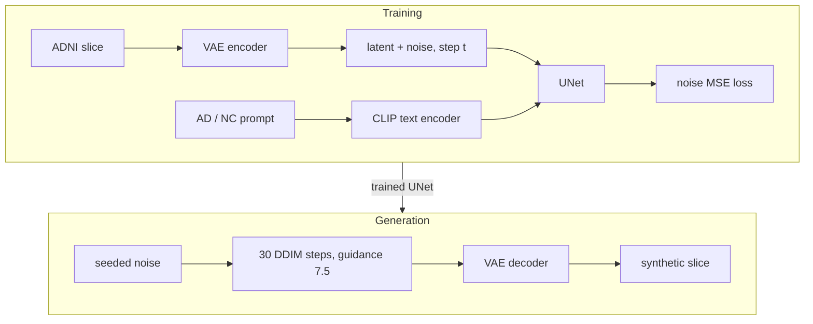

# Synthetic brain MRI with Stable Diffusion: fidelity, coverage and memorisation on ADNI

COMP3710 final report, Section 2.4 (image generation, Hard difficulty) ·
liquidtoy001 · `recognition/sd_adni_liquidtoy001`

> Final results are on 102 test subjects that no model, recipe or threshold
> saw before the evaluation code was frozen
> ([protocol](docs/final-evaluation-protocol.md), committed before the test
> split was read). Section 7 reports the validation results that led there.

## Summary

Hospitals cannot share brain MRI freely, so synthetic scans are attractive for
augmentation and open research, but only if they are realistic, cover the real
variety of anatomy, and do not reproduce the patients they were learned from.
This project adapts **Stable Diffusion 1.5**, a latent diffusion model
pretrained on natural images, to generate 256 × 256 sagittal brain MRI slices of
Alzheimer's disease (AD) and normal control (NC) subjects from the ADNI dataset,
and measures all three requirements on held-out patients. It compares two
adaptation methods (fine-tuning the whole denoising UNet, and a 0.8 M-parameter
LoRA adapter) against simpler generative baselines trained on the same data: a
conditional VAE, a conditional GAN, per-class GANs and a latent diffusion model
trained from scratch.

**How it works.** A frozen autoencoder compresses each slice to a 4 × 32 × 32
latent. During training, Gaussian noise of a random strength is added to the
latent and a UNet, conditioned on a text prompt for the class ("a brain MRI
slice, Alzheimer disease"), learns to predict that noise. Generation starts from
pure noise and removes it in 30 DDIM steps, pushed towards the requested class by
classifier-free guidance, then decodes the latent back to an image. The
training loop, the sampler, the data pipeline and every evaluation are written
for this project in PyTorch; the pretrained weights and building blocks come from
`diffusers`, `transformers` and `peft`.



**Results at a glance** (test split, 1,024 samples per model; real slices
score SSIM 0.707, KID 0.06 and coverage 0.81):

| Model | SSIM (course target 0.6) | KID x 100 (lower is better) | Coverage (higher is better) | Membership AUC (0.5 = no leak) | Verdict |
| --- | ---: | ---: | ---: | ---: | --- |
| **Full fine-tune**, cleaned data (E2) | **0.704** | **1.27** | **0.27** | 0.736 | best samples; the model leaks who trained it |
| **LoRA adapter**, same recipe (E3) | 0.696 | 4.25 | 0.07 | 0.529 | small leak, but far narrower coverage |
| Diffusion from scratch, 92 M (B3) | 0.703 | 1.99 | 0.24 | 1.000 | near-copies of training slices |
| Conditional VAE (B1) | 0.718 | 23.84 | 0.00 | | blurry averages |
| Conditional GAN (B2) | 0.582 | 38.98 | 0.00 | | one template per class |
| SD 1.5, no training (SD) | 0.088 | 29.25 | 0.00 | 0.499 (control) | natural images |

**Recommendation** (by a rule fixed before testing): **E2**, for producing a
synthetic cohort to share. Its samples are no copies and sit at most 1.4%
closer to training slices than held-out slices would; its *weights* must not
be shared, because a simple loss test recognises 13.5% of training slices at a
1% false-alarm rate (Section 10).

**The models, by what changed.** The codes are kept because the
[experiment ledger](docs/experiments.md) and the protocols use them.

| Code | Model | What it changes, and why |
| --- | --- | --- |
| SD | Stable Diffusion 1.5 as downloaded | nothing: what natural-image pretraining alone gives |
| E0 | First LoRA run: a rank-4 adapter, 20,000 steps at batch 1 | the first adaptation attempt (grey backgrounds, colour casts) |
| E1 | Full fine-tune of the UNet with the recipe (offset noise, prompt dropout, EMA, 10 epochs) | fixes E0's failures; trains all 860 M weights |
| E2 | E1 without two defective training scans | data cleaning: removes E1's blank samples |
| E3 | E0's small adapter trained with E2's recipe | capacity back down to 0.8 M weights: was it the recipe or the size? |
| R1-E2, R1-E3 | E2 and E3 retrained with a second seed | how much of a difference is training noise |
| B1 | Conditional VAE, trained from scratch at 128 px | the course's simple autoencoder baseline |
| B2 | Conditional GAN, adapted from the student's demonstration-2 GAN | the classic mode-collapse case |
| B2b | One GAN per class | an attempt to avoid B2's collapse (it failed) |
| B3 | A 92 M diffusion UNet trained from scratch in SD's latent space | no pretraining: does SD's pretraining matter? |

## Contents

1. [The engineering dilemma](#1-the-engineering-dilemma)
2. [Feasibility review](#2-feasibility-review)
3. [Data, split and pre-processing](#3-data-split-and-pre-processing)
4. [Method](#4-method)
5. [Baselines](#5-baselines)
6. [How the models are judged, and why](#6-how-the-models-are-judged-and-why)
7. [The path to the final recipe (validation)](#7-the-path-to-the-final-recipe-validation)
8. [Test-split results](#8-test-split-results)
9. [Failure autopsies](#9-failure-autopsies)
10. [Recommendation for the project manager](#10-recommendation-for-the-project-manager)
11. [Conclusion](#11-conclusion)
12. [Reproducing the results](#12-reproducing-the-results)
13. [Limitations](#13-limitations)
14. [Artificial Intelligence Usage Disclosure](#14-artificial-intelligence-usage-disclosure)
15. [References](#15-references)

## 1. The engineering dilemma

Section 2.4 frames synthetic medical imaging as a trilemma. Each corner has a
model family that is prone to it, and each needs its own measurement:

| Corner of the trilemma | What goes wrong | Prone model family | Measured here by |
| --- | --- | --- | --- |
| 1. Blurry or collapsed anatomy | samples are smooth averages, or a few templates | VAE (blur), GAN (mode collapse) | SSIM, KID/FID, precision/recall/coverage, within-class diversity |
| 2. Hallucinated anatomy | impossible tissue junctions, artefacts | any, worst when under-trained | uncurated grids, rule-selected failure autopsy, t-SNE, a blinded real/synthetic sort |
| 3. Memorised patients | samples reproduce training scans; the model leaks who was in the training set | high-capacity models on small data | nearest-training distances calibrated on held-out patients, membership inference, closest-pair review |

Two lessons from this project shaped that table. A completely collapsed GAN still
scored mean SSIM 0.58 (B2, Section 9), so SSIM cannot see missing coverage. A
from-scratch diffusion model matched the best SSIM while reproducing training
layouts (B3), so SSIM cannot see memorisation either. No single number answers
the dilemma.

## 2. Feasibility review

The one-page review presented at check-off on 15 October 2026 (tutor check-off
recorded; all four discussion points accepted), reproduced with its outcome.

**User need, scope and acceptance criteria.** A research engineer needs to know
whether synthetic 2D brain MRI slices are realistic and diverse enough to share
or augment data, without reproducing training patients. This prototype measures
that trade-off; it does not establish clinical utility, anonymisation or safe
public release. Five testable criteria:

| # | Criterion | Outcome |
| --- | --- | --- |
| 1 | Zero cross-split subject, scan and file-hash overlap | met: subject-level split, checked by `dataset.py` on every load |
| 2 | Finite, reproducible training on one A100 40 GB within job limits, with measured memory and time | met: every run logged; E2 trains in 45 min at 23.8 GiB peak |
| 3 | Original SD, LoRA SD (E0, E3), fully fine-tuned SD (E1, E2) and a simple baseline compared under one SSIM protocol, reporting the course's 0.6 target honestly | met: on test, E2 0.704 and E3 0.696 (99% of samples above 0.6); SD 0.088 and B2 0.582 below it |
| 4 | Uncurated grids, feature distances, t-SNE, nearest-neighbour audits and 3-5 failure cases | met (Sections 7-9) |
| 5 | Pre-registered acceptance criteria for every training run, committed before it starts | met: one protocol per run in [docs](docs), each committed before its first job |

**Model choice and course concepts.** ADNI: 30,520 slices, 680 subjects.
Filename numbers are scan IDs; the original train/test folders share no scan but
share 216 subjects, so the project splits by subject (476/102/102). Stable
Diffusion 1.5 latent diffusion (Hard) at 256 px: frozen VAE and text encoder,
noise-prediction MSE, own training loop. Concepts: latent compression, forward
noising, denoising, classifier-free guidance, fine-tuning capacity (Rombach et
al., 2022).

**Measured evidence at check-off.** E1 and E2 trained 10 epochs in 45 min each
on one A100 (93 images/s, 23.8 GiB peak). Feature-nearest SSIM over 64 fixed
seeds: original SD 0.087, E0 0.377, E1 0.688, E2 0.705 (64/64 above 0.6), VAE
0.727 (blurrier), real validation slices 0.710. E1's 7/32 blank NC samples traced
to one defective training scan; removing it (E2) gave 0/32.

**Risks, budget, fallback.** Pixel and feature metrics favour smooth images; one
defective-scan rule may miss subtler artefacts; pixel distance cannot prove the
absence of memorisation. Budget about 6 A100-hours. Fallback: report the
validation results. **After check-off**, following the tutor's feedback, the
project added the GAN and from-scratch diffusion baselines, a capacity ablation
(E3), seed replicates (R1), and a test protocol with a model-based membership
test.

## 3. Data, split and pre-processing

**Data.** The course copy of ADNI on Rangpur (`/home/groups/comp3710/ADNI`):
30,520 grayscale 2D slices from 680 subjects, labelled AD or NC.

**Split, by subject.** The course folders separate scans, not people: 216
subjects appear in both the original train and test folders under different
scan IDs. Evaluating on them would test recall of known patients, which is the
opposite of what the memorisation question needs. The project therefore pools
the folders and assigns whole subjects to 70/15/15% train, validation and test,
stratified by class, by sorting each class's subjects on SHA-256 of
`3710:subject_id` ([data protocol](docs/data-protocol.md)):

| Split | Subjects (AD / NC) | Slices (AD / NC) | Used for |
| --- | --- | --- | --- |
| Train | 476 (155 / 321) | 21,280 (10,160 / 11,120) | training; nearest-training references |
| Validation | 102 (33 / 69) | 4,540 (2,260 / 2,280) | every model and recipe decision; calibration |
| Test | 102 (33 / 69) | 4,700 (2,440 / 2,260) | read once, after the evaluation code was frozen |

Every slice's SHA-256 is recorded in the manifest and checked when loaded.

**Pre-processing** (`dataset.py`): grayscale; zero-pad to a square so anatomy is
not stretched; bilinear resize to 256 × 256 (SD1.5's latent grid is 32 × 32 at
this size); replicate to three channels because the pretrained VAE expects RGB;
scale to [-1, 1]. No augmentation: flipping a sagittal slice would swap
anterior and posterior, which no real scan shows.

**Defective-scan exclusion** (from E2 on). A slice is near-empty when fewer than
5% of its pixels exceed 10% intensity; a scan with any near-empty slice is
excluded whole, since its other slices are suspect too. The rule was fixed on
training data only, before E2 ran, and removes 2 NC scans (40 slices, 0.19% of
training slices). Section 9 shows why it matters.

## 4. Method

### 4.1 Latent diffusion

The frozen SD1.5 VAE encoder maps an image *x* to a latent
*z*₀ = 0.18215 · E(*x*). The forward process adds noise at step *t* of 1,000:

*z*ₜ = √ᾱₜ · *z*₀ + √(1 − ᾱₜ) · ε,  ε ~ N(0, I)

and the UNet ε_θ is trained to predict ε from (*z*ₜ, *t*, *c*), where *c* is the
CLIP embedding of the class prompt (Rombach et al., 2022, eq. 2):

L = E‖ε − ε_θ(*z*ₜ, *t*, *c*)‖²

Sampling runs deterministic DDIM (Song et al., 2021) for 30 steps with
classifier-free guidance (Ho & Salimans, 2022):

ε̂ = ε_θ(*z*ₜ, *t*, ∅) + *w* · (ε_θ(*z*ₜ, *t*, *c*) − ε_θ(*z*ₜ, *t*, ∅)),  *w* = 7.5

`modules.guided_ddim` implements this loop; a unit test checks it against
diffusers' `StableDiffusionPipeline` to 1e-5.

### 4.2 The architecture, and what is trained

Stable Diffusion 1.5 has three networks (Rombach et al., 2022):

- **Autoencoder** (84 M parameters, frozen). A convolutional KL-regularised VAE
  whose encoder reduces a 256 × 256 × 3 image by 8 in each direction to a
  4 × 32 × 32 latent, and whose decoder maps latents back to images. Latents
  are multiplied by the scaling factor stored in the checkpoint's configuration
  (0.18215) so they have roughly unit variance; the code reads it from the
  configuration rather than hard-coding it.
- **Text encoder** (123 M, frozen). CLIP ViT-L/14 turns each prompt into a
  77 × 768 sequence of token embeddings: "a brain MRI slice, Alzheimer disease",
  "a brain MRI slice, normal control", or the empty prompt.
- **Denoising UNet** (860 M). Four down-sampling stages (320, 640, 1280, 1280
  channels), a middle block and four mirrored up-sampling stages joined by skip
  connections. Each down-sampling stage holds two residual blocks and each up-sampling stage three; they receive the noise
  step *t* through a sinusoidal embedding and an MLP; the first three stages and
  their mirrors also hold transformer blocks, in which self-attention mixes
  positions in the latent and cross-attention lets every position attend to
  the 77 prompt tokens. Cross-attention is how the class reaches the image.

What each model trains:

| Model | Trainable part | Parameters | Weight file |
| --- | --- | ---: | ---: |
| E2 | every UNet weight | 859.5 M | 1.7 GB |
| E3 | LoRA on every attention projection (q, k, v, out) of the UNet: each frozen weight *W* gets a trainable update *W* + *B A*, with *A* of shape 4 × d_in and *B* of shape d_out × 4 (Hu et al., 2022) | 0.80 M | 1.6 MB |
| B3 | a smaller UNet of the same design (128, 256, 384, 384 channels), from random initialisation | 92.2 M | 0.18 GB |

`modules.py` builds and loads these (`load_unet`, `add_lora`, `build_unet`
with the B3 configuration `SCRATCH_UNET`); the noise schedule, loss, EMA,
guided sampler and DDIM inversion are written there too.

### 4.3 The training recipe, and the failure each part fixes

| Setting | Value | Why |
| --- | --- | --- |
| Epochs, batch | 10 epochs at batch 16 (13,270 steps) | E0's 20,000 steps at batch 1 were under one epoch |
| Optimiser | AdamW, lr 1e-5 (E2) or 1e-4 (E3), 500 warm-up steps, weight decay 0.01, gradient clip 1.0 | a fine-tuning rate for 860 M weights; adapters tolerate a larger one |
| Offset noise | 0.1 | SD1.5 cannot learn a global brightness shift with zero-mean noise, which left E0 with grey backgrounds (Guttenberg, 2023; Lin et al., 2024) |
| Prompt dropout | 10% empty prompt | guidance uses the empty-prompt branch; untrained on MRI, it pulled E0 towards colourful natural images |
| EMA weights | decay 0.999 with (1+n)/(10+n) warm-up | smoother weights for sampling |
| Defective-scan exclusion | 2 scans | E1 amplified one blank scan into 7/32 blank NC samples |
| Precision | float32 weights, bfloat16 autocast, cached VAE latents | 93 images/s on one A100 |
| Validation loss | 1,024 fixed slices, fixed noise and timesteps, separate seed | changes reflect the weights only |

### 4.4 Code

| File | Contents |
| --- | --- |
| `dataset.py` | manifest-validated loader, hash checks, the defective-scan rule |
| `modules.py` | model loading, LoRA, loss, EMA, guided DDIM sampler, DDIM inversion |
| `train.py` | training loop, validation loss, curves, sample grids, weights |
| `predict.py` | fixed-seed generation from saved weights, grids and a hashed report |
| `tools/` | baselines, Slurm wrappers, audits and the final evaluation |
| `tests/` | CPU tests with tiny models (sampler, inversion, metrics, data contract) |

## 5. Baselines

| Name | Model | Why it is here |
| --- | --- | --- |
| SD | Stable Diffusion 1.5, zero-shot | the starting point: what pretraining alone gives |
| E0 | Codex's first rank-4 LoRA run (20,000 steps at batch 1) | the project's first attempt; what the recipe changed |
| **B1** | conditional convolutional VAE, 128 px, trained from scratch | the course's "basic autoencoder" baseline |
| **B2** | conditional DCGAN-style GAN, 128 px, adapted from the student's demonstration-2 GAN (logistic loss, R1 penalty, minibatch standard deviation, EMA) | the textbook mode-collapse case |
| B2b | one unconditional GAN per class, same recipe | could a GAN avoid B2's collapse? |
| **B3** | 92 M-parameter UNet trained from scratch in SD's latent space, same pipeline as E2 | does SD's natural-image pretraining help on 21 k slices? |
| R1 | E2 and E3 retrained with a second seed | how much differences between models exceed seed noise |

## 6. How the models are judged, and why

The tutor asked for the reason behind each measure and how it behaved. All
measures run on the same fixed seeds (37200 onwards, per class) and, for the
final results, on the same 102 test subjects.

| Measure | How | Why it was chosen | How it behaved |
| --- | --- | --- | --- |
| Feature-nearest SSIM (course target 0.6) | each sample against its nearest held-out slice of the same class (one per patient) in frozen-VAE feature space | the course's structural measure | separates SD (0.09) from fine-tuned models (0.70), but scores a collapsed GAN 0.58 and a blurry VAE 0.73: blind to coverage and rewards smoothness |
| KID and FID | Inception-v3 features, 1,024 samples against the class-balanced held-out set; a real-slice floor at the same size | standard distribution distances; KID is unbiased at 1,024 samples | ranks the models clearly where SSIM could not: E2 1.27 against B3 1.99, E3 4.25, VAE 23.8, GAN 39.0 (floor 0.06); FID agrees |
| Precision, recall, density, coverage | Naeem et al. (2020), k = 5 | splits "looks real" from "covers the data", which SSIM conflates | the VAE and GAN score 0 on all four despite SSIM 0.72 and 0.58; E2 covers 27% of real neighbourhoods against the floor's 81%, the largest remaining gap |
| Training preference (M2) | per sample, log(nearest-training / nearest-held-out distance), minus the same for real held-out slices | corrects the confound that smooth samples sit close to every real slice | flags B3 (28% closer to training); E2 within 0.6-1.4%; E3 none |
| Membership inference (M3) | denoising loss on 1,024 training versus 1,024 held-out slices; AUC against SD as control | asks whether the model itself reveals its training patients | separates what M2 cannot: E2 0.736 and B3 1.000 leak, E3 0.529 barely; SD 0.499 |
| Closest pairs, autopsy, grids | visual review, selection rules fixed in advance | the only way to tell a copy from a neighbour, or an artefact from anatomy | found E1's blank samples and B3's replicated layouts |
| Cost | training time and memory; sampling time and memory at batch 1 and 16 | Section 2.4 asks for VRAM, parameters and latency | Section 8 |

## 7. The path to the final recipe (validation)

All rows: 64 fixed-seed samples, validation split. Real validation slices score
SSIM 0.710 and mean nearest-training RMSE 0.0731.

| Model | Feature-nearest SSIM | Samples > 0.6 | Border (grey background) | Colour range | Nearest-training RMSE | Note |
| --- | ---: | ---: | ---: | ---: | ---: | --- |
| SD 1.5, no training (SD) | 0.087 | 0/64 | 0.440 | 0.345 | 0.486 | natural images |
| First LoRA, no recipe (E0) | 0.377 | 23/64 | 0.059 | 0.021 | 0.112 | grey backgrounds, cyan tints |
| Full fine-tune + recipe (E1) | 0.688 | 60/64 | 0.0016 | 0.0061 | 0.0655 | 7/32 blank NC samples |
| **Full fine-tune**, cleaned data (E2) | **0.705** | 64/64 | 0.00007 | 0.0059 | 0.0673 | E1 without 2 defective scans |
| **LoRA adapter**, same recipe (E3) | **0.696** | 63/64 | 0.0004 | 0.0061 | 0.0846 | E2's recipe, E0's adapter |
| Full fine-tune, 2nd seed (R1-E2) | 0.701 | 64/64 | | | 0.0730 | second seed |
| Conditional VAE (B1) | 0.727 | 64/64 | 0.00008 | 0 | 0.0565 | visibly blurry |
| Conditional GAN (B2) | 0.581 | 32/64 | 0.049 | 0 | 0.1254 | one template per class |
| Diffusion from scratch, 92 M (B3) | 0.710 | 64/64 | 0.0005 | 0.0056 | 0.0516 | replicates training layouts |


*The same seeds through every model (synthetic images only). SD draws natural
textures; E0 draws one pose on a grey field; E1's last NC sample is blank (the
defective scan); E2 and E3 draw varied, plausible slices; the VAE is blurry; the
GAN repeats one template per class; B3 resembles E2 but replicates training
layouts (Section 9).*

What each step showed:

- **E0 to E1: the recipe fixes the failures, not capacity alone.** Offset noise
  removed the grey background (border 0.059 to 0.002) and prompt dropout the
  colour artefacts; SSIM rose from 0.38 to 0.69.
- **E1 to E2: data cleaning.** Seven blank NC samples came from one defective
  scan, 0.26% of NC training slices. Excluding two such scans removed them all.
- **E3: capacity is not the bottleneck.** E0's tiny adapter with E2's recipe
  reaches SSIM 0.696, so of the 0.328 gain from E0 to E2, the recipe accounts for
  0.319 and fine-tuning all 860 M weights for 0.009.
- **B3: pretraining buys generalisation, not fidelity.** A UNet a ninth of the
  size, trained from scratch, matches E2's SSIM, but its validation loss rises
  from epoch 23 while training loss keeps falling, and its samples sit 29%
  closer to training slices than to held-out ones (E2: 9%, E3: 5%).
- **B2 and B2b: GANs collapse here.** Both the conditional GAN and the per-class
  GANs drew one non-anatomical template per class (Section 9).

Full records: [experiment ledger](docs/experiments.md), one pre-registered
protocol per experiment in [docs](docs).

## 8. Test-split results

All ten models were evaluated once on the 102 test subjects (4,700 slices),
with 1,024 samples each (seeds 37200-37711 per class) and the code frozen at
commit `2104414`; B2b had no model to evaluate. Intervals are bootstrap 95%
intervals over samples; "E2, seed 2" and "E3, seed 2" are the R1 replicates,
which show how much of a difference is training noise. The real floor is 1,024
validation slices scored as if they were a generator.

### 8.1 Fidelity and coverage

| Model | Feature-nearest SSIM (95% CI) | > 0.6 | KID x 100 | FID | Precision | Recall | Density | Coverage |
| --- | ---: | ---: | ---: | ---: | ---: | ---: | ---: | ---: |
| Real slices (floor) | 0.707 | 100% | 0.06 | 8.4 | 0.754 | 0.755 | 0.648 | 0.813 |
| SD 1.5, no training (SD) | 0.088 (0.084 to 0.091) | 0% | 29.25 ± 0.32 | 311.0 | 0.000 | 0.476 | 0.000 | 0.000 |
| First LoRA, no recipe (E0) | 0.328 (0.310 to 0.346) | 36% | 10.92 ± 0.22 | 89.0 | 0.079 | 0.001 | 0.021 | 0.028 |
| **Full fine-tune**, cleaned data (E2) | 0.704 (0.703 to 0.706) | 99% | 1.27 ± 0.08 | 22.7 | 0.267 | 0.849 | 0.103 | 0.274 |
| Full fine-tune, 2nd seed (R1-E2) | 0.702 (0.700 to 0.704) | 99% | 1.19 ± 0.07 | 20.9 | 0.302 | 0.816 | 0.111 | 0.288 |
| **LoRA adapter**, same recipe (E3) | 0.696 (0.694 to 0.698) | 99% | 4.25 ± 0.14 | 48.7 | 0.065 | 0.675 | 0.019 | 0.066 |
| LoRA adapter, 2nd seed (R1-E3) | 0.694 (0.691 to 0.697) | 96% | 4.19 ± 0.15 | 47.6 | 0.044 | 0.751 | 0.011 | 0.035 |
| Diffusion from scratch, 92 M (B3) | 0.703 (0.701 to 0.705) | 99% | 1.99 ± 0.10 | 28.3 | 0.279 | 0.803 | 0.101 | 0.242 |
| Conditional VAE (B1) | 0.718 (0.716 to 0.719) | 100% | 23.84 ± 0.29 | 187.9 | 0.000 | 0.000 | 0.000 | 0.000 |
| Conditional GAN (B2) | 0.582 (0.576 to 0.587) | 49% | 38.98 ± 0.31 | 297.4 | 0.000 | 0.000 | 0.000 | 0.000 |

- **The course target is met** by every fine-tuned diffusion model and the
  VAE; SSIM cannot separate them (0.694-0.718).
- **The distribution measures can.** E2 has the lowest KID and FID and the
  highest coverage of any model, reproduced by its second seed. B3 comes
  second; E3's KID is three times E2's and its coverage a quarter.
- **The baselines fail the coverage corner outright.** The VAE (SSIM 0.718)
  and the GAN score zero precision, recall, density and coverage: blurry
  averages and one template per class lie outside every real neighbourhood.
- **The gap to real data is coverage, not SSIM:** E2 covers 27% of real
  neighbourhoods against 81% for real slices, and its precision (0.27 against
  0.75) says many samples carry features real slices do not (Section 9).

### 8.2 Memorisation and membership

| Model | Nearest-training RMSE, mean (min) | M2 pixel: difference (95% CI) | Closer to training (negative: farther) | M2 VAE: difference (95% CI) | Membership AUC | AUC minus SD (95% CI) | TPR at 1% FPR |
| --- | ---: | ---: | ---: | ---: | ---: | ---: | ---: |
| Real held-out slices | 0.0745 (0.0424) | 0 (calibration) | 0% | 0 (calibration) | | | |
| SD 1.5, no training (SD) | 0.4914 (0.2663) | +0.0740 (0.0712 to 0.0768) | -7.7% | +0.0932 (0.0895 to 0.0969) | 0.499 | control | 3.0% |
| First LoRA, no recipe (E0) | 0.1184 (0.0620) | +0.0273 (0.0219 to 0.0326) | -2.8% | +0.0572 (0.0514 to 0.0631) | n/a | n/a | n/a |
| **Full fine-tune**, cleaned data (E2) | 0.0683 (0.0387) | -0.0064 (-0.0131 to 0.0004) | +0.6% | -0.0145 (-0.0233 to -0.0058) | 0.736 | +0.237 (0.219 to 0.255) | 13.5% |
| Full fine-tune, 2nd seed (R1-E2) | 0.0711 (0.0374) | -0.0043 (-0.0111 to 0.0027) | +0.4% | -0.0122 (-0.0212 to -0.0034) | 0.732 | +0.234 (0.216 to 0.252) | 13.3% |
| **LoRA adapter**, same recipe (E3) | 0.0823 (0.0506) | +0.0257 (0.0207 to 0.0308) | -2.6% | +0.0269 (0.0202 to 0.0336) | 0.529 | +0.030 (0.014 to 0.047) | 1.8% |
| LoRA adapter, 2nd seed (R1-E3) | 0.0770 (0.0520) | +0.0106 (0.0049 to 0.0161) | -1.1% | +0.0109 (0.0040 to 0.0178) | 0.531 | +0.032 (0.016 to 0.049) | 1.9% |
| Diffusion from scratch, 92 M (B3) | 0.0519 (0.0172) | -0.3334 (-0.3515 to -0.3154) | +28.3% | -0.2720 (-0.2885 to -0.2566) | 1.000 | +0.501 (0.476 to 0.526) | 100.0% |
| Conditional VAE (B1) | 0.0560 (0.0347) | -0.0305 (-0.0372 to -0.0236) | +3.0% | +0.0337 (0.0290 to 0.0385) | n/a | n/a | n/a |
| Conditional GAN (B2) | 0.1243 (0.0849) | +0.0745 (0.0711 to 0.0780) | -7.7% | +0.0494 (0.0456 to 0.0533) | n/a | n/a | n/a |

- **Samples (M2).** B3's samples are 28% closer to training slices than
  held-out slices would be, and its closest pairs are near-copies (three
  different seeds reproduce one training slice). E2's pixel-space interval
  touches zero (-0.0131 to +0.0004); in VAE features its samples are 1.4%
  closer. E3's samples are slightly farther from training than held-out slices.
- **Models (M3).** The loss test, with SD as control (AUC 0.499), recognises
  B3's training slices perfectly (AUC 1.000) and E2's well (0.736; 13.5% of
  training slices caught at 1% false alarms), both reproduced by the second
  seeds. E3 leaks far less (0.529, 1.8%), but its interval excludes zero.
- **What separates the two.** Sharing samples and sharing weights are
  different risks: E2's samples carry little of its training set, but its
  weights do.


### 8.3 Uncurated samples and the embedding

The first 32 seeds per class of the two candidates, exactly as generated (no
selection):

| E2 | E3 |
| --- | --- |
|  |  |


E2, E3 and B3 fall inside the cloud of real slices; SD, E0, the VAE and the
GAN form their own clusters away from it. AD and NC are mixed within the
real cloud: in these features a single slice carries little sign of its class.

**Does the requested class show in the samples?** (post-hoc, not
pre-registered.) A linear probe, fitted on validation slices only, separates
real AD from NC test slices with AUC 0.76. Read on each model's samples, split
by the class asked for, it gives:

| | Real test slices | Full fine-tune (E2) | LoRA adapter (E3) | From scratch (B3) | First LoRA (E0) | VAE (B1) | GAN (B2) | No training (SD) |
| --- | ---: | ---: | ---: | ---: | ---: | ---: | ---: | ---: |
| Probe AUC, AD against NC | 0.76 | **0.95** | 0.92 | 0.76 | 0.77 | 0.53 | 0.96 | 0.49 |


The conditioning works: E2's AD and NC samples differ in the direction real AD
and NC slices differ. But they differ *more* than real slices do. The samples
are caricatures of their class, probably because guidance 7.5 extrapolates
along the class direction (not tested). The VAE barely uses its class input,
and SD, untrained, not at all; the GAN's separation comes from drawing one
template per class.

### 8.4 Interpolation

Section 2.4 asks for latent interpolation between synthetic images and training
scans. Between two synthetic samples (I1, below), E2's frames change
continuously and no interior frame comes closer to a training slice than the
closest real pair (0.042); one NC path changes brightness and size abruptly
between frames 5 and 6. From a training slice (I2: the slice is inverted to
starting noise by DDIM inversion, then interpolated towards a synthetic
sample), the endpoint is reconstructed to RMSE 0.04-0.06 and the distance to
the training slice rises steadily to a typical sample distance (about 0.06):
the model leaves the training slice gradually rather than snapping between
stored images. The I2 panels contain training slices and stay private;
the numbers are in [test-interpolation-2026-10-19.json](docs/test-interpolation-2026-10-19.json).


### 8.5 Resource profile

One NVIDIA A100-PCIE-40GB throughout. Training figures come from each run's
own `metrics.json`; sampling was profiled in one job (672915): median of 20 timed
batches after 3 warm-up batches, DDIM 30 with guidance 7.5 and decoding
included. "Deterministic" is the setting every cohort was generated with;
"fast" enables TF32, cuDNN autotuning and fused attention, as a deployment
would.

| Model | Trainable parameters | Weight file | Training (wall) | Training peak memory | Seconds per image, batch 1 (det. / fast) | Seconds per image, batch 16 (det. / fast) | Sampling peak memory, batch 1 / 16 |
| --- | ---: | ---: | ---: | ---: | ---: | ---: | ---: |
| **Full fine-tune** (E2) | 859.5 M | 1.7 GB | 43 min (10 epochs, 93 img/s) | 23.8 GiB | 1.97 / 1.32 | 0.49 / 0.23 | 3.8 / 8.7 GiB |
| **LoRA adapter** (E3) | 0.80 M | 1.6 MB | 38 min (10 epochs, 105 img/s) | 36.8 GiB | 2.67 / 1.96 | 0.54 / 0.27 | 3.8 / 8.7 GiB |
| Diffusion from scratch (B3) | 92.2 M | 0.18 GB | 110 min (98 epochs, 401 img/s) | 34.3 GiB | 1.90 / 1.29 | 0.32 / 0.11 | 0.9 / 5.8 GiB |
| Conditional VAE (B1) | 1.27 M | 5 MB | 3 min (5 epochs) | 0.15 GiB | 0.001 | < 0.001 | 0.4 GiB |
| Conditional GAN (B2) | 9.2 M (G) + 12.5 M (D) | 37 MB (G) | 105 min (29,000 steps) | 3.8 GiB | 0.002 | < 0.001 | 0.5 GiB |

Three observations. The adapter trains 13% faster and its file is a thousand
times smaller, but its training peak memory is *higher* than full fine-tuning
(36.8 against 23.8 GiB); the likely cause, not verified, is that PEFT's adapter
layers keep float32 copies of their inputs under bfloat16 autocast. Unmerged
adapters also sample 35% slower at batch 1; merging the adapter into the UNet
weights would remove that cost. And the trilemma's speed corner is real: the
GAN and the VAE sample a thousand times faster than any diffusion model, and
fail the other two corners (Section 9).

## 9. Failure autopsies

Representative failures from actual runs on Rangpur, each with its root cause.

1. **Grey backgrounds and colour casts (E0).** *Symptom:* 23/64 samples usable;
   the rest had grey fields where MRI is black (border intensity 0.059) and cyan
   tints that grew with guidance. *Root cause:* SD1.5's noise schedule leaves
   signal at its final step, so zero-mean noise training cannot learn a global
   intensity shift, and guidance extrapolates from an empty-prompt branch never
   trained on MRI. *Fix:* offset noise and 10% prompt dropout (E1).
2. **Blank NC samples (E1).** *Symptom:* 7/32 NC samples nearly black.
   *Root cause:* their nearest training slices all came from one defective scan
   (0.26% of NC slices); the model reproduced a rare, extreme training item.
   *Fix:* a foreground rule fixed on training data, excluding 2 scans (E2: 0/32).
3. **Mode collapse (B2, B2b).** *Symptom:* within each class, every sample is the
   same smooth, non-anatomical template from the first check at step 1,000.
   *Root cause:* the conditional generator ignored its noise (Mao et al., 2019);
   the collapse rule did not fire because its diversity ratio pooled both classes.
   Per-class GANs (B2b) collapsed too, even after a calibration bug was fixed.
4. **Layout replication (B3).** *Symptom:* the closest samples reproduce a
   specific training slice's outline, ventricles and cerebellum, with smeared
   gyri. *Root cause:* 92 M parameters trained from scratch on 21 k slices
   overfit (validation loss minimal at epoch 23, rising for 75 epochs); this is
   the replication Somepalli et al. (2023) describe.
**5. The recommended model's worst test samples (E2).** Selected by the rule
fixed in advance (the 5 lowest SSIM of 1,024, plus any near-empty sample; there
were none), so they are not cherry-picked:


| Sample (SSIM) | What is wrong | Likely trigger (not verified) |
| --- | --- | --- |
| NC-37263 (0.536), NC-37595 (0.586) | over-bright, flattened grey-white contrast; anatomy cut off at the frame edge | guidance 7.5 pushes intensities to extremes; off-centre slices are rare in training |
| NC-37407 (0.563) | posterior fossa (brainstem, cerebellum) dissolves into ragged, disordered tissue | the region varies most between slices and subjects, so the model averages incompatible shapes |
| NC-37489 (0.577) | a stripe runs from the brainstem to the image edge; a bright rim surrounds the cortex | some training slices keep skull-stripping remnants, which the model reproduces and exaggerates |
| NC-37341 (0.587) | lower half replaced by dark, mottled texture with no anatomy | the same posterior-fossa failure, more severe |

All five are NC, the class with twice the subjects and more variety. These are
the "physiologically impossible tissue junctions" of Section 2.4: rare, but
present, and the reason E2's precision (0.27) is far below real slices' (0.75).
A downstream model trained on unfiltered samples could learn them.

## 10. Recommendation for the project manager

**Recommendation: E2 (full UNet fine-tuning), to generate a synthetic cohort;
do not share its weights.**

*How it was chosen.* By the rule fixed in the protocol before the test split
was read: (1) neither E2 nor E3 is excluded (both SSIM > 0.6, no copies);
(2) both show a memorisation signal, since E3's membership excess
(+0.030, interval 0.014-0.047) excludes zero, so this step does not decide;
(3) E2's coverage (0.274) exceeds E3's (0.066) by far more than the seed
spread. The rule treats a signal as present or absent; it does not weigh its
size, which is why the size is stated next.

**Verdict on the E2 cohort**, against the protocol's criteria:

| Question | Verdict | Evidence |
| --- | --- | --- |
| Structural fidelity | **passes** | SSIM 0.704 (interval 0.703-0.706), 99% of samples above 0.6; real slices 0.707 |
| Non-memorised samples | **largely, not fully** | no copies among the closest pairs; samples at most 0.6% (pixels, interval includes 0) to 1.4% (features) closer to training slices than held-out slices would be |
| Non-memorised model | **fails** | membership AUC 0.736 against 0.499 for the control; 13.5% of training slices recognised at 1% false alarms; same with a second seed |
| Coverage | **best of all models, far from real** | KID 1.27 x 10⁻² (floor 0.06), coverage 0.27 (floor 0.81) |
| Plausibility | **plausible to a non-expert, with rare impossible anatomy** | uncurated grids, t-SNE inside the real cloud; the autopsy above; blinded sort pending |
| Fit for downstream training | **not established** | no train-on-synthetic, test-on-real study was run |

**Trade-offs for the decision.**

- *If only images leave the hospital:* E2. It gives the most realistic and most
  varied cohort, and its samples carry little of the training set. Screen out
  the rare impossible slices (for example, by the posterior-fossa and
  frame-edge failures above) before use.
- *If the model itself must be shared:* not E2, and not B3. E3 leaks far less
  (AUC 0.529) at a 1.6 MB file size, but covers a quarter as much of the real
  data; a model trained with differential privacy would be the next step.
- *If cost dominates:* the adapter trains in 38 minutes and stores in 1.6 MB,
  against 43 minutes and 1.7 GB, but samples 35% slower unless merged.
- *Never* use a diffusion model trained from scratch on a dataset this size
  (B3): it matches E2's SSIM while reproducing training slices.

**What the project manager should not conclude.** That the cohort is
anonymous: membership inference shows the training set is recoverable from the
model. That it is clinically valid: no radiologist reviewed it. That it helps a
classifier: not tested, and its classes are exaggerated (Section 8.3).

## 11. Conclusion

Fine-tuning Stable Diffusion 1.5 on 21,240 ADNI training slices produced the
most realistic and most varied synthetic slices of every model tested: SSIM
0.704 on unseen patients (real slices 0.707), the lowest KID and the highest
coverage, with no copies of training slices and the requested class clearly
present. The trilemma of Section 2.4 did not disappear; it moved. No model
escaped all three corners:

1. **Blur and collapse** ruled out the simple baselines: the VAE's averages
   and the GAN's single template per class score zero coverage while passing or
   nearly passing the SSIM target.
2. **Hallucinated anatomy** remains rare but real in the best model: a
   disordered posterior fossa, structures running off the frame, over-bright
   slices, and class differences exaggerated beyond real data.
3. **Memorisation** grew with fit. Trained from scratch, a diffusion model
   reproduces training slices (B3); fine-tuned in full, it keeps few traces in
   its samples but reveals its training set through its loss (E2); the small
   adapter leaks far less (E3) but covers a quarter as much of the real data.

Three lessons carry beyond this project. The training recipe and data cleaning,
not capacity, delivered the fidelity (E0 to E3, Section 7). Pretraining on
natural images bought generalisation rather than fidelity (B3). And no single
number answers the dilemma: SSIM missed both a collapsed GAN and a replicating
diffusion model, which only distribution and membership measures exposed.

**Next steps**, in order of expected value: fine-tune with differential privacy
or stop earlier to cut E2's membership leak; lower the guidance to reduce class
exaggeration and widen coverage; then a radiologist review and a
train-on-synthetic, test-on-real classifier study before any use of the cohort.

## 12. Reproducing the results

**Environment.** Rangpur, one NVIDIA A100-PCIE-40GB per job. Python 3.11.15,
PyTorch 2.13.0+cu130, torchvision 0.28.0+cu130, diffusers 0.40.0, transformers
5.18.0, peft 0.21.2, accelerate 1.15.0, huggingface-hub 1.33.0, safetensors
0.8.0, NumPy 2.4.6, Pillow 12.3.0, matplotlib 3.10.9
([requirements-train.txt](requirements-train.txt) and the files it includes).
Local analysis: [requirements-evaluation.txt](requirements-evaluation.txt).
Stable Diffusion 1.5 revision `451f4fe16113bff5a5d2269ed5ad43b0592e9a14`,
downloaded once with hashes recorded; jobs run offline.

**Train E2** (about 45 min):

```bash
python train.py --output outputs/e2 --exclude-defective-scans --expect-excluded 2 40
```

**Train E3** (about 38 min):

```bash
python train.py --output outputs/e3 --exclude-defective-scans --expect-excluded 2 40 --trainable lora --lora-rank 4 --lr 1e-4
```

**Generate** (fixed seeds 37200 onwards per class, DDIM 30, guidance 7.5):

```bash
python predict.py --weights outputs/e2/weights/unet-ema-epoch-10.safetensors --output outputs/e2-cohort --count 32
```

`predict.py` writes one PNG per sample, labelled and grayscale grids, and
`report.json` with every file's SHA-256 and appearance statistics.

**Tests** (CPU, tiny models):

```bash
python -m unittest discover -s tests
```

**Determinism.** Seeds are fixed for data order (3710), validation draws (3710)
and every generated sample. Generation runs with deterministic cuDNN and cuBLAS
settings and reproduces earlier cohorts byte for byte; training enables TF32
for speed and is reproducible in its records, not bit for bit. Slurm wrappers in
`tools/` record each job; the ledger lists every job ID.

## 13. Limitations

- No radiologist review: "plausible" means plausible to a non-expert.
- Downstream utility (training a classifier on synthetic data) is not measured.
- 2D slices only; one dataset; two seeds for E2 and E3, one for each baseline.
- FID and KID use ImageNet Inception features, a convention rather than a
  validated measure for MRI.
- Pixel and feature distances cannot prove the absence of memorisation; the
  membership test bounds one attack, not all.

## 14. Artificial Intelligence Usage Disclosure

The dated record of every AI-assisted step, including mistakes, is
[AI_USAGE.md](AI_USAGE.md). In summary:

**Tools.** OpenAI Codex (2–8 October 2026) and Anthropic Claude Code with
Claude Opus 5.5 (12–25 October 2026), both used as coding and research
assistants with access to the repository and, through the student's account, to
Rangpur.

**What they assisted with.**

- *Codex:* interpreting the assessment; the Rangpur and ADNI audit that found
  the 216 subjects shared between the original folders; the subject-level split
  and `dataset.py`; the VAE reconstruction check; E0 (the first LoRA run); the
  first cohort, nearest-neighbour, appearance, SSIM and t-SNE audits; the B1
  VAE; the first check-off draft.
- *Claude Code:* reviewing Codex's work against the v2.2/v2.3 specification;
  `modules.py`, `train.py` and `predict.py`; the E1, E2, E3 and R1 runs; the B2,
  B2b and B3 baselines; the final evaluation tools (`tools/final_*.py`,
  `membership.py`, `interpolate_final.py`, `profile_sampling.py`); the
  pre-registered protocols; the experiment ledger; this README.
- *The student* chose the project, approved each protocol and every GPU run
  before it started, decided on reruns and file deletions, presented the
  feasibility review at check-off, and relayed the tutor's feedback, which
  reshaped the evaluation (the trilemma framing, the metric rationale, the extra
  baselines).

**How the work was audited and verified.**

- *Pre-registration.* Every experiment's hypotheses and pass criteria were
  committed before its first job ([docs](docs)); deviations are dated errata in
  the [ledger](docs/experiments.md), and unmet criteria are reported as unmet.
- *Tests.* CPU unit tests with tiny models (`tests/`) check the sampler against
  diffusers' official pipeline, exact DDIM inversion, batch equivalence, the
  metrics against closed forms (FID for Gaussians, PRDC extremes, AUC by hand),
  the data contract and the exporters. Key tests were shown to fail on
  deliberately broken code.
- *Provenance.* SHA-256 of every source file copied to Rangpur, every model
  weight file and every generated image, checked before use; dry runs of every
  Slurm wrapper with stub commands before submission.
- *Reproduction.* New evaluation code had to reproduce every earlier validation
  SSIM to six decimals before the test split was read.
- *Visual review.* Every uncurated grid and every closest-pair panel was
  inspected before a number was interpreted; this is how E1's blank samples, the
  GAN collapse and B3's replication were found.
- *Mistakes found and fixed* (all listed in AI_USAGE.md): a misdescribed metric
  in the B2 protocol, corrected before running; a collapse rule that pooled
  classes; a BatchNorm calibration bug in the per-class GAN; an over-strict disk
  check; batched sampling that did not reproduce earlier images, replaced by
  one-image sampling.
- *Student verification:* to be confirmed by the student before submission.

## 15. References

- Rombach, R., et al. High-Resolution Image Synthesis with Latent Diffusion Models. CVPR 2022.
- Song, J., Meng, C., Ermon, S. Denoising Diffusion Implicit Models. ICLR 2021.
- Ho, J., Salimans, T. Classifier-Free Diffusion Guidance. NeurIPS Workshop 2021.
- Hu, E., et al. LoRA: Low-Rank Adaptation of Large Language Models. ICLR 2022.
- Guttenberg, N. Diffusion with Offset Noise. Crosslabs blog, 2023.
- Lin, S., et al. Common Diffusion Noise Schedules and Sample Steps Are Flawed. WACV 2024.
- Heusel, M., et al. GANs Trained by a Two Time-Scale Update Rule Converge to a Local Nash Equilibrium (FID). NeurIPS 2017.
- Bińkowski, M., et al. Demystifying MMD GANs (KID). ICLR 2018.
- Naeem, M. F., et al. Reliable Fidelity and Diversity Metrics for Generative Models. ICML 2020.
- Carlini, N., et al. Extracting Training Data from Diffusion Models. USENIX Security 2023.
- Duan, J., et al. Are Diffusion Models Vulnerable to Membership Inference Attacks? ICML 2023.
- Somepalli, G., et al. Diffusion Art or Digital Forgery? Investigating Data Replication in Diffusion Models. CVPR 2023.
- Mao, Q., et al. Mode Seeking Generative Adversarial Networks for Diverse Image Synthesis. CVPR 2019.
- Mescheder, L., et al. Which Training Methods for GANs do actually Converge? (R1 penalty). ICML 2018.
- Kingma, D. P., Welling, M. Auto-Encoding Variational Bayes. ICLR 2014.
- Wang, Z., et al. Image Quality Assessment: From Error Visibility to Structural Similarity. IEEE TIP 2004.
