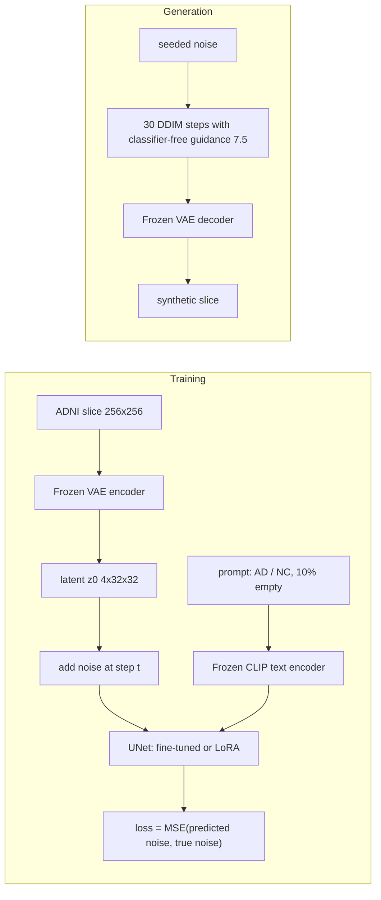

# Synthetic brain MRI with Stable Diffusion: fidelity, coverage and memorisation on ADNI

COMP3710 final report, Section 2.4 (image generation, Hard difficulty) ·
liquidtoy001 · `recognition/sd_adni_liquidtoy001`

> **Draft.** Sections marked *pending test run* are filled in from the sealed
> test-split evaluation ([protocol](docs/final-evaluation-protocol.md)). Every
> other number is on the validation split and is final.

## Summary

Hospitals cannot share brain MRI freely, so synthetic scans are attractive for
augmentation and open research, but only if they are realistic, cover the real
variety of anatomy, and do not reproduce the patients they were learned from.
This project adapts **Stable Diffusion 1.5**, a latent diffusion model
pretrained on natural images, to generate 256 × 256 sagittal brain MRI slices of
Alzheimer's disease (AD) and normal control (NC) subjects from the ADNI dataset,
and measures all three requirements on held-out patients. It compares two
adaptation methods (fine-tuning the whole denoising UNet, and a 0.8 M-parameter
LoRA adapter) against simpler generative baselines trained on the same data: a
conditional VAE, a conditional GAN, per-class GANs and a latent diffusion model
trained from scratch.

**How it works.** A frozen autoencoder compresses each slice to a 4 × 32 × 32
latent. During training, Gaussian noise of a random strength is added to the
latent and a UNet, conditioned on a text prompt for the class ("a brain MRI
slice, Alzheimer disease"), learns to predict that noise. Generation starts from
pure noise and removes it in 30 DDIM steps, pushed towards the requested class by
classifier-free guidance, then decodes the latent back to an image. The
training loop, the sampler, the data pipeline and every evaluation are written
for this project in PyTorch; the pretrained weights and building blocks come from
`diffusers`, `transformers` and `peft`.



**Results at a glance** (test split, 1,024 samples per model): *pending test run*.

<!-- RESULTS-AT-A-GLANCE -->

## Contents

1. [The engineering dilemma](#1-the-engineering-dilemma)
2. [Feasibility review](#2-feasibility-review)
3. [Data, split and pre-processing](#3-data-split-and-pre-processing)
4. [Method](#4-method)
5. [Baselines](#5-baselines)
6. [How the models are judged, and why](#6-how-the-models-are-judged-and-why)
7. [The path to the final recipe (validation)](#7-the-path-to-the-final-recipe-validation)
8. [Test-split results](#8-test-split-results)
9. [Failure autopsies](#9-failure-autopsies)
10. [Recommendation for the project manager](#10-recommendation-for-the-project-manager)
11. [Reproducing the results](#11-reproducing-the-results)
12. [Limitations](#12-limitations)
13. [Artificial Intelligence Usage Disclosure](#13-artificial-intelligence-usage-disclosure)
14. [References](#14-references)

## 1. The engineering dilemma

Section 2.4 frames synthetic medical imaging as a trilemma. Each corner has a
model family that is prone to it, and each needs its own measurement:

| Corner of the trilemma | What goes wrong | Prone model family | Measured here by |
| --- | --- | --- | --- |
| 1. Blurry or collapsed anatomy | samples are smooth averages, or a few templates | VAE (blur), GAN (mode collapse) | SSIM, KID/FID, precision/recall/coverage, within-class diversity |
| 2. Hallucinated anatomy | impossible tissue junctions, artefacts | any, worst when under-trained | uncurated grids, rule-selected failure autopsy, t-SNE, a blinded real/synthetic sort |
| 3. Memorised patients | samples reproduce training scans; the model leaks who was in the training set | high-capacity models on small data | nearest-training distances calibrated on held-out patients, membership inference, closest-pair review |

Two lessons from this project shaped that table. A completely collapsed GAN still
scored mean SSIM 0.58 (B2, Section 9), so SSIM cannot see missing coverage. A
from-scratch diffusion model matched the best SSIM while reproducing training
layouts (B3), so SSIM cannot see memorisation either. No single number answers
the dilemma.

## 2. Feasibility review

The one-page review presented at check-off on 15 October 2026 (tutor check-off
recorded; all four discussion points accepted), reproduced with its outcome.

**User need, scope and acceptance criteria.** A research engineer needs to know
whether synthetic 2D brain MRI slices are realistic and diverse enough to share
or augment data, without reproducing training patients. This prototype measures
that trade-off; it does not establish clinical utility, anonymisation or safe
public release. Five testable criteria:

| # | Criterion | Outcome |
| --- | --- | --- |
| 1 | Zero cross-split subject, scan and file-hash overlap | met: subject-level split, checked by `dataset.py` on every load |
| 2 | Finite, reproducible training on one A100 40 GB within job limits, with measured memory and time | met: every run logged; E2 trains in 45 min at 23.8 GiB peak |
| 3 | Original SD, LoRA SD (E0, E3), fully fine-tuned SD (E1, E2) and a simple baseline compared under one SSIM protocol, reporting the course's 0.6 target honestly | met on validation; test: *pending test run* |
| 4 | Uncurated grids, feature distances, t-SNE, nearest-neighbour audits and 3-5 failure cases | met (Sections 7-9) |
| 5 | Pre-registered acceptance criteria for every training run, committed before it starts | met: one protocol per run in [docs](docs), each committed before its first job |

**Model choice and course concepts.** ADNI: 30,520 slices, 680 subjects.
Filename numbers are scan IDs; the original train/test folders share no scan but
share 216 subjects, so the project splits by subject (476/102/102). Stable
Diffusion 1.5 latent diffusion (Hard) at 256 px: frozen VAE and text encoder,
noise-prediction MSE, own training loop. Concepts: latent compression, forward
noising, denoising, classifier-free guidance, fine-tuning capacity (Rombach et
al., 2022).

**Measured evidence at check-off.** E1 and E2 trained 10 epochs in 45 min each
on one A100 (93 images/s, 23.8 GiB peak). Feature-nearest SSIM over 64 fixed
seeds: original SD 0.087, E0 0.377, E1 0.688, E2 0.705 (64/64 above 0.6), VAE
0.727 (blurrier), real validation slices 0.710. E1's 7/32 blank NC samples traced
to one defective training scan; removing it (E2) gave 0/32.

**Risks, budget, fallback.** Pixel and feature metrics favour smooth images; one
defective-scan rule may miss subtler artefacts; pixel distance cannot prove the
absence of memorisation. Budget about 6 A100-hours. Fallback: report the
validation results. **After check-off**, following the tutor's feedback, the
project added the GAN and from-scratch diffusion baselines, a capacity ablation
(E3), seed replicates (R1), and a test protocol with a model-based membership
test.

## 3. Data, split and pre-processing

**Data.** The course copy of ADNI on Rangpur (`/home/groups/comp3710/ADNI`):
30,520 grayscale 2D slices from 680 subjects, labelled AD or NC.

**Split, by subject.** The course folders separate scans, not people: 216
subjects appear in both the original train and test folders under different
scan IDs. Evaluating on them would test recall of known patients, which is the
opposite of what the memorisation question needs. The project therefore pools
the folders and assigns whole subjects to 70/15/15% train, validation and test,
stratified by class, by sorting each class's subjects on SHA-256 of
`3710:subject_id` ([data protocol](docs/data-protocol.md)):

| Split | Subjects (AD / NC) | Slices (AD / NC) | Used for |
| --- | --- | --- | --- |
| Train | 476 (155 / 321) | 21,280 (10,160 / 11,120) | training; nearest-training references |
| Validation | 102 (33 / 69) | 4,540 (2,260 / 2,280) | every model and recipe decision; calibration |
| Test | 102 (33 / 69) | 4,700 (2,440 / 2,260) | read once, after the evaluation code was frozen |

Every slice's SHA-256 is recorded in the manifest and checked when loaded.

**Pre-processing** (`dataset.py`): grayscale; zero-pad to a square so anatomy is
not stretched; bilinear resize to 256 × 256 (SD1.5's latent grid is 32 × 32 at
this size); replicate to three channels because the pretrained VAE expects RGB;
scale to [-1, 1]. No augmentation: flipping a sagittal slice would swap
anterior and posterior, which no real scan shows.

**Defective-scan exclusion** (from E2 on). A slice is near-empty when fewer than
5% of its pixels exceed 10% intensity; a scan with any near-empty slice is
excluded whole, since its other slices are suspect too. The rule was fixed on
training data only, before E2 ran, and removes 2 NC scans (40 slices, 0.19% of
training slices). Section 9 shows why it matters.

## 4. Method

### 4.1 Latent diffusion

The frozen SD1.5 VAE encoder maps an image *x* to a latent
*z*₀ = 0.18215 · E(*x*). The forward process adds noise at step *t* of 1,000:

*z*ₜ = √ᾱₜ · *z*₀ + √(1 − ᾱₜ) · ε,  ε ~ N(0, I)

and the UNet ε_θ is trained to predict ε from (*z*ₜ, *t*, *c*), where *c* is the
CLIP embedding of the class prompt (Rombach et al., 2022, eq. 2):

L = E‖ε − ε_θ(*z*ₜ, *t*, *c*)‖²

Sampling runs deterministic DDIM (Song et al., 2021) for 30 steps with
classifier-free guidance (Ho & Salimans, 2022):

ε̂ = ε_θ(*z*ₜ, *t*, ∅) + *w* · (ε_θ(*z*ₜ, *t*, *c*) − ε_θ(*z*ₜ, *t*, ∅)),  *w* = 7.5

`modules.guided_ddim` implements this loop; a unit test checks it against
diffusers' `StableDiffusionPipeline` to 1e-5.

### 4.2 What is trained

| Model | Trainable part | Parameters | Weight file |
| --- | --- | ---: | ---: |
| E2 | the whole SD1.5 UNet | 859.5 M | 1.7 GB |
| E3 | rank-4 LoRA on every attention projection (q, k, v, out) | 0.80 M | 1.6 MB |

The VAE and the text encoder stay frozen in both.

### 4.3 The training recipe, and the failure each part fixes

| Setting | Value | Why |
| --- | --- | --- |
| Epochs, batch | 10 epochs at batch 16 (13,270 steps) | E0's 20,000 steps at batch 1 were under one epoch |
| Optimiser | AdamW, lr 1e-5 (E2) or 1e-4 (E3), 500 warm-up steps, weight decay 0.01, gradient clip 1.0 | a fine-tuning rate for 860 M weights; adapters tolerate a larger one |
| Offset noise | 0.1 | SD1.5 cannot learn a global brightness shift with zero-mean noise, which left E0 with grey backgrounds (Guttenberg, 2023; Lin et al., 2024) |
| Prompt dropout | 10% empty prompt | guidance uses the empty-prompt branch; untrained on MRI, it pulled E0 towards colourful natural images |
| EMA weights | decay 0.999 with (1+n)/(10+n) warm-up | smoother weights for sampling |
| Defective-scan exclusion | 2 scans | E1 amplified one blank scan into 7/32 blank NC samples |
| Precision | float32 weights, bfloat16 autocast, cached VAE latents | 93 images/s on one A100 |
| Validation loss | 1,024 fixed slices, fixed noise and timesteps, separate seed | changes reflect the weights only |

### 4.4 Code

| File | Contents |
| --- | --- |
| `dataset.py` | manifest-validated loader, hash checks, the defective-scan rule |
| `modules.py` | model loading, LoRA, loss, EMA, guided DDIM sampler, DDIM inversion |
| `train.py` | training loop, validation loss, curves, sample grids, weights |
| `predict.py` | fixed-seed generation from saved weights, grids and a hashed report |
| `tools/` | baselines, Slurm wrappers, audits and the final evaluation |
| `tests/` | CPU tests with tiny models (sampler, inversion, metrics, data contract) |

## 5. Baselines

| Name | Model | Why it is here |
| --- | --- | --- |
| SD | Stable Diffusion 1.5, zero-shot | the starting point: what pretraining alone gives |
| E0 | Codex's first rank-4 LoRA run (20,000 steps at batch 1) | the project's first attempt; what the recipe changed |
| **B1** | conditional convolutional VAE, 128 px, trained from scratch | the course's "basic autoencoder" baseline |
| **B2** | conditional DCGAN-style GAN, 128 px, adapted from the student's demonstration-2 GAN (logistic loss, R1 penalty, minibatch standard deviation, EMA) | the textbook mode-collapse case |
| B2b | one unconditional GAN per class, same recipe | could a GAN avoid B2's collapse? |
| **B3** | 92 M-parameter UNet trained from scratch in SD's latent space, same pipeline as E2 | does SD's natural-image pretraining help on 21 k slices? |
| R1 | E2 and E3 retrained with a second seed | how much differences between models exceed seed noise |

## 6. How the models are judged, and why

The tutor asked for the reason behind each measure and how it behaved. All
measures run on the same fixed seeds (37200 onwards, per class) and, for the
final results, on the same 102 test subjects.

| Measure | How | Why it was chosen | How it behaved |
| --- | --- | --- | --- |
| Feature-nearest SSIM (course target 0.6) | each sample against its nearest held-out slice of the same class (one per patient) in frozen-VAE feature space | the course's structural measure | separates SD (0.09) from fine-tuned models (0.70), but scores a collapsed GAN 0.58 and a blurry VAE 0.73: blind to coverage and rewards smoothness |
| KID and FID | Inception-v3 features, 1,024 samples against the class-balanced held-out set; a real-slice floor at the same size | standard distribution distances; KID is unbiased at 1,024 samples | *pending test run* |
| Precision, recall, density, coverage | Naeem et al. (2020), k = 5 | splits "looks real" from "covers the data", which SSIM conflates | *pending test run* |
| Training preference (M2) | per sample, log(nearest-training / nearest-held-out distance), minus the same for real held-out slices | corrects the confound that smooth samples sit close to every real slice | rehearsal: flags B3 strongly, not E2 or E3 |
| Membership inference (M3) | denoising loss on 1,024 training versus 1,024 held-out slices; AUC against SD as control | asks whether the model itself reveals its training patients | rehearsal: E2 leaks (AUC 0.68 vs 0.47), E3 does not |
| Closest pairs, autopsy, grids | visual review, selection rules fixed in advance | the only way to tell a copy from a neighbour, or an artefact from anatomy | found E1's blank samples and B3's replicated layouts |
| Cost | training time and memory; sampling time and memory at batch 1 and 16 | Section 2.4 asks for VRAM, parameters and latency | Section 8 |

## 7. The path to the final recipe (validation)

All rows: 64 fixed-seed samples, validation split. Real validation slices score
SSIM 0.710 and mean nearest-training RMSE 0.0731.

| Model | Feature-nearest SSIM | Samples > 0.6 | Border (grey background) | Colour range | Nearest-training RMSE | Note |
| --- | ---: | ---: | ---: | ---: | ---: | --- |
| SD zero-shot | 0.087 | 0/64 | 0.440 | 0.345 | 0.486 | natural images |
| E0 | 0.377 | 23/64 | 0.059 | 0.021 | 0.112 | grey backgrounds, cyan tints |
| E1 | 0.688 | 60/64 | 0.0016 | 0.0061 | 0.0655 | 7/32 blank NC samples |
| **E2** | **0.705** | 64/64 | 0.00007 | 0.0059 | 0.0673 | E1 without 2 defective scans |
| **E3** | **0.696** | 63/64 | 0.0004 | 0.0061 | 0.0846 | E2's recipe, E0's adapter |
| R1-E2 | 0.701 | 64/64 | | | 0.0730 | second seed |
| B1 VAE | 0.727 | 64/64 | 0.00008 | 0 | 0.0565 | visibly blurry |
| B2 GAN | 0.581 | 32/64 | 0.049 | 0 | 0.1254 | one template per class |
| B3 scratch LDM | 0.710 | 64/64 | 0.0005 | 0.0056 | 0.0516 | replicates training layouts |

What each step showed:

- **E0 to E1: the recipe fixes the failures, not capacity alone.** Offset noise
  removed the grey background (border 0.059 to 0.002) and prompt dropout the
  colour artefacts; SSIM rose from 0.38 to 0.69.
- **E1 to E2: data cleaning.** Seven blank NC samples came from one defective
  scan, 0.26% of NC training slices. Excluding two such scans removed them all.
- **E3: capacity is not the bottleneck.** E0's tiny adapter with E2's recipe
  reaches SSIM 0.696, so of the 0.328 gain from E0 to E2, the recipe accounts for
  0.319 and fine-tuning all 860 M weights for 0.009.
- **B3: pretraining buys generalisation, not fidelity.** A UNet a ninth of the
  size, trained from scratch, matches E2's SSIM, but its validation loss rises
  from epoch 23 while training loss keeps falling, and its samples sit 29%
  closer to training slices than to held-out ones (E2: 9%, E3: 5%).
- **B2 and B2b: GANs collapse here.** Both the conditional GAN and the per-class
  GANs drew one non-anatomical template per class (Section 9).

Full records: [experiment ledger](docs/experiments.md), one pre-registered
protocol per experiment in [docs](docs).

## 8. Test-split results

*Pending test run.* Planned contents, as fixed in the
[protocol](docs/final-evaluation-protocol.md): the benchmark table for all ten
models with bootstrap 95% CIs and the real floor; uncurated grids; t-SNE with
ground-truth colours; the memorisation and membership results; interpolation
between synthetic samples and from training slices; and the resource table.

<!-- TEST-RESULTS -->

## 9. Failure autopsies

Representative failures from actual runs on Rangpur, each with its root cause.

1. **Grey backgrounds and colour casts (E0).** *Symptom:* 23/64 samples usable;
   the rest had grey fields where MRI is black (border intensity 0.059) and cyan
   tints that grew with guidance. *Root cause:* SD1.5's noise schedule leaves
   signal at its final step, so zero-mean noise training cannot learn a global
   intensity shift, and guidance extrapolates from an empty-prompt branch never
   trained on MRI. *Fix:* offset noise and 10% prompt dropout (E1).
2. **Blank NC samples (E1).** *Symptom:* 7/32 NC samples nearly black.
   *Root cause:* their nearest training slices all came from one defective scan
   (0.26% of NC slices); the model reproduced a rare, extreme training item.
   *Fix:* a foreground rule fixed on training data, excluding 2 scans (E2: 0/32).
3. **Mode collapse (B2, B2b).** *Symptom:* within each class, every sample is the
   same smooth, non-anatomical template from the first check at step 1,000.
   *Root cause:* the conditional generator ignored its noise (Mao et al., 2019);
   the collapse rule did not fire because its diversity ratio pooled both classes.
   Per-class GANs (B2b) collapsed too, even after a calibration bug was fixed.
4. **Layout replication (B3).** *Symptom:* the closest samples reproduce a
   specific training slice's outline, ventricles and cerebellum, with smeared
   gyri. *Root cause:* 92 M parameters trained from scratch on 21 k slices
   overfit (validation loss minimal at epoch 23, rising for 75 epochs); this is
   the replication Somepalli et al. (2023) describe.
5. **The recommended model's worst test samples.** *Pending test run:* the five
   lowest-SSIM test samples, selected by rule.

## 10. Recommendation for the project manager

*Pending test run.* The choice between E2 and E3 follows the rule fixed in the
protocol: exclude a model below SSIM 0.6 or with copies; prefer the model
without a memorisation signal; then higher coverage; otherwise the smaller E3.

## 11. Reproducing the results

**Environment.** Rangpur, one NVIDIA A100-PCIE-40GB per job. Python 3.11.15,
PyTorch 2.13.0+cu130, torchvision 0.28.0+cu130, diffusers 0.40.0, transformers
5.18.0, peft 0.21.2, accelerate 1.15.0, huggingface-hub 1.33.0, safetensors
0.8.0, NumPy 2.4.6, Pillow 12.3.0, matplotlib 3.10.9
([requirements-train.txt](requirements-train.txt) and the files it includes).
Local analysis: [requirements-evaluation.txt](requirements-evaluation.txt).
Stable Diffusion 1.5 revision `451f4fe16113bff5a5d2269ed5ad43b0592e9a14`,
downloaded once with hashes recorded; jobs run offline.

**Train E2** (about 45 min):

```bash
python train.py --output outputs/e2 --exclude-defective-scans --expect-excluded 2 40
```

**Train E3** (about 38 min):

```bash
python train.py --output outputs/e3 --exclude-defective-scans --expect-excluded 2 40 --trainable lora --lora-rank 4 --lr 1e-4
```

**Generate** (fixed seeds 37200 onwards per class, DDIM 30, guidance 7.5):

```bash
python predict.py --weights outputs/e2/weights/unet-ema-epoch-10.safetensors --output outputs/e2-cohort --count 32
```

`predict.py` writes one PNG per sample, labelled and grayscale grids, and
`report.json` with every file's SHA-256 and appearance statistics.

**Tests** (CPU, tiny models):

```bash
python -m unittest discover -s tests
```

**Determinism.** Seeds are fixed for data order (3710), validation draws (3710)
and every generated sample. Generation runs with deterministic cuDNN and cuBLAS
settings and reproduces earlier cohorts byte for byte; training enables TF32
for speed and is reproducible in its records, not bit for bit. Slurm wrappers in
`tools/` record each job; the ledger lists every job ID.

## 12. Limitations

- No radiologist review: "plausible" means plausible to a non-expert.
- Downstream utility (training a classifier on synthetic data) is not measured.
- 2D slices only; one dataset; two seeds for E2 and E3, one for each baseline.
- FID and KID use ImageNet Inception features, a convention rather than a
  validated measure for MRI.
- Pixel and feature distances cannot prove the absence of memorisation; the
  membership test bounds one attack, not all.

## 13. Artificial Intelligence Usage Disclosure

*To be completed from [AI_USAGE.md](AI_USAGE.md).*

## 14. References

- Rombach, R., et al. High-Resolution Image Synthesis with Latent Diffusion Models. CVPR 2022.
- Song, J., Meng, C., Ermon, S. Denoising Diffusion Implicit Models. ICLR 2021.
- Ho, J., Salimans, T. Classifier-Free Diffusion Guidance. NeurIPS Workshop 2021.
- Hu, E., et al. LoRA: Low-Rank Adaptation of Large Language Models. ICLR 2022.
- Guttenberg, N. Diffusion with Offset Noise. Crosslabs blog, 2023.
- Lin, S., et al. Common Diffusion Noise Schedules and Sample Steps Are Flawed. WACV 2024.
- Heusel, M., et al. GANs Trained by a Two Time-Scale Update Rule Converge to a Local Nash Equilibrium (FID). NeurIPS 2017.
- Bińkowski, M., et al. Demystifying MMD GANs (KID). ICLR 2018.
- Naeem, M. F., et al. Reliable Fidelity and Diversity Metrics for Generative Models. ICML 2020.
- Carlini, N., et al. Extracting Training Data from Diffusion Models. USENIX Security 2023.
- Duan, J., et al. Are Diffusion Models Vulnerable to Membership Inference Attacks? ICML 2023.
- Somepalli, G., et al. Diffusion Art or Digital Forgery? Investigating Data Replication in Diffusion Models. CVPR 2023.
- Mao, Q., et al. Mode Seeking Generative Adversarial Networks for Diverse Image Synthesis. CVPR 2019.
- Mescheder, L., et al. Which Training Methods for GANs do actually Converge? (R1 penalty). ICML 2018.
- Kingma, D. P., Welling, M. Auto-Encoding Variational Bayes. ICLR 2014.
- Wang, Z., et al. Image Quality Assessment: From Error Visibility to Structural Similarity. IEEE TIP 2004.
