# Synthetic brain MRI with Stable Diffusion: fidelity, coverage and memorisation on ADNI

**QITAI LI (49133336)** · COMP3710 final report · Section 2.4, image generation
(Hard) · `recognition/sd_adni_liquidtoy001`

## Summary

Synthetic brain MRI is only useful if it is realistic, covers the real variety
of anatomy, and does not reproduce the patients it was learned from. This
project fine-tunes **Stable Diffusion 1.5** to generate 256 × 256 sagittal ADNI
slices of Alzheimer's disease (AD) and normal control (NC) subjects, and tests
all three requirements on 102 held-out patients. Two adaptations, full UNet
fine-tuning and a 0.8 M-parameter LoRA adapter, are compared with four simpler
generators trained on the same data.

**How it works.** A frozen autoencoder compresses each slice to a 4 × 32 × 32
latent. In training, noise of a random strength is added to the latent and the
UNet, conditioned on a class prompt, learns to predict it. Generation starts
from noise, removes it in 30 DDIM steps with classifier-free guidance, and
decodes the result. The training loop, sampler, data pipeline and all
evaluation are this project's own PyTorch code; pretrained weights and layers
come from `diffusers`, `transformers` and `peft`.

<p align="center">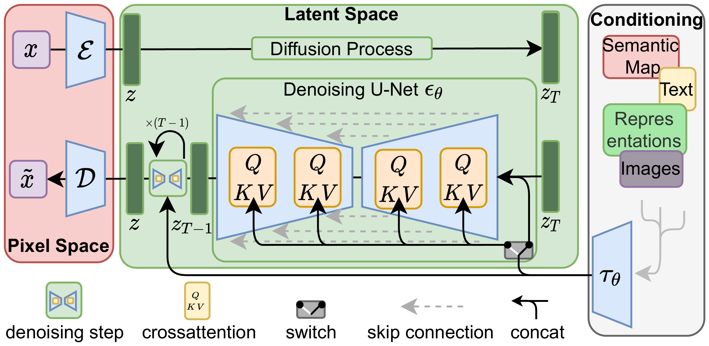</p>

*Latent diffusion, the architecture of Stable Diffusion (Rombach et al., 2022,
Fig. 3; rendered from the vector original in the paper's
[arXiv source](https://arxiv.org/abs/2112.10752); the same figure ships in the
authors' [CompVis/latent-diffusion](https://github.com/CompVis/latent-diffusion)
repository, MIT licence). Here ℰ and 𝒟 are SD1.5's frozen VAE, the
conditioning is a class prompt only ("a brain MRI slice, Alzheimer disease"
or "a brain MRI slice, normal control"), and τ_θ is the frozen CLIP text encoder. What each
model trains is shown in Section 4.*

**Results** on the test split (1,024 samples per model; real slices score SSIM
0.707, KID 0.06, coverage 0.81):

| Model | SSIM (target 0.6) | KID x 100 (lower better) | Coverage (higher better) | Membership AUC (0.5 = no leak) | In one line |
| --- | ---: | ---: | ---: | ---: | --- |
| **Full fine-tune**, cleaned data (E2) | **0.704** | **1.27** | **0.27** | 0.736 | best samples; the model leaks who trained it |
| **LoRA adapter**, same recipe (E3) | 0.696 | 4.25 | 0.07 | 0.529 | small leak, narrow coverage |
| Diffusion from scratch, 92 M (B3) | 0.703 | 1.99 | 0.24 | 1.000 | near-copies of training slices |
| Conditional VAE (B1) | 0.718 | 23.84 | 0.00 | | blurry averages |
| Conditional GAN (B2) | 0.582 | 38.98 | 0.00 | | one template per class |
| SD 1.5, no training (SD) | 0.088 | 29.25 | 0.00 | 0.499 (control) | natural images |

**Recommendation** (by a rule fixed before testing): use **E2** to produce a
synthetic cohort, but never share its weights. Its samples are not copies, yet
a simple loss test recognises 13.5% of its training slices at a 1% false-alarm
rate (Section 9).

**The models.** Codes match the [experiment ledger](docs/experiments.md) and
the protocols in [docs](docs).

| Code | Model | What it changes, and why |
| --- | --- | --- |
| SD | Stable Diffusion 1.5 as downloaded | nothing: what natural-image pretraining alone gives |
| E0 | First LoRA run: rank-4 adapter, 20,000 steps at batch 1 | first attempt (grey backgrounds, colour casts) |
| E1 | Full UNet fine-tune with the recipe (offset noise, prompt dropout, EMA, 10 epochs) | fixes E0's failures; trains all 860 M weights |
| E2 | E1 without two defective training scans | data cleaning: removes E1's blank samples |
| E3 | E0's adapter trained with E2's recipe | recipe or capacity? 0.8 M weights instead of 860 M |
| R1 | E2 and E3 retrained with a second seed | how much of a difference is training noise |
| B1 | Conditional VAE, 128 px, from scratch | the course's simple autoencoder baseline |
| B2 | Conditional GAN adapted from the student's demonstration-2 GAN (logistic loss, R1 penalty, EMA) | the classic mode-collapse case |
| B2b | One GAN per class | an attempt to avoid B2's collapse (failed) |
| B3 | 92 M UNet trained from scratch in SD's latent space | no pretraining: does it matter? |

## Contents

1. [The engineering dilemma](#1-the-engineering-dilemma)
2. [Feasibility review](#2-feasibility-review)
3. [Data, split and pre-processing](#3-data-split-and-pre-processing)
4. [Method](#4-method)
5. [How the models are judged](#5-how-the-models-are-judged)
6. [From E0 to E3 (validation)](#6-from-e0-to-e3-validation)
7. [Test results](#7-test-results)
8. [Failure autopsies](#8-failure-autopsies)
9. [Recommendation](#9-recommendation)
10. [Conclusion](#10-conclusion)
11. [Reproducing the results](#11-reproducing-the-results)
12. [Limitations](#12-limitations)
13. [Artificial Intelligence Usage Disclosure](#13-artificial-intelligence-usage-disclosure)
14. [References](#14-references)

## 1. The engineering dilemma

Section 2.4 frames synthetic medical imaging as a trilemma. Each corner has a
model family prone to it, and each needs its own measure:

| Corner | What goes wrong | Prone family | Measured by |
| --- | --- | --- | --- |
| Blur or collapse | smooth averages, or a few templates | VAE, GAN | SSIM, KID/FID, precision/recall/coverage |
| Hallucinated anatomy | impossible tissue junctions, artefacts | any | uncurated grids, rule-selected autopsy, t-SNE, blinded sort |
| Memorised patients | samples copy training scans; the model reveals who trained it | large models, small data | calibrated nearest-neighbour distances, membership inference, closest pairs |

No single number covers all three: a collapsed GAN still scores SSIM 0.58, and a
diffusion model that replicates training slices matches the best SSIM.

## 2. Feasibility review

Presented at check-off on 15 October 2026 (recorded; the tutor accepted all four
discussion points), shown here with outcomes.

**User need and scope.** A research engineer needs to know whether synthetic 2D
brain MRI is realistic and diverse enough to share or augment data without
reproducing patients. The prototype measures that trade-off; it does not
establish clinical utility or anonymity.

| # | Acceptance criterion | Outcome |
| --- | --- | --- |
| 1 | No subject, scan or file shared across splits | met: subject-level split, hash-checked on every load |
| 2 | Reproducible training on one A100 40 GB within job limits, memory and time measured | met: E2 trains in 43 min at 23.8 GiB |
| 3 | SD, LoRA and full fine-tuning against a simple baseline under one SSIM protocol, 0.6 target reported honestly | met: test SSIM E2 0.704, E3 0.696; SD and the GAN below 0.6 |
| 4 | Uncurated grids, feature distances, t-SNE, nearest-neighbour audits, 3-5 failure cases | met (Sections 6-8) |
| 5 | Acceptance criteria committed before every training run | met: one protocol per run in [docs](docs) |

**Model and course concepts.** ADNI has 30,520 slices from 680 subjects; the
course folders share 216 subjects, so the data are re-split by subject. Stable
Diffusion 1.5 latent diffusion (Rombach et al., 2022; Hard tier) at 256 px,
with a frozen VAE and text encoder and an own training loop. Course concepts:
latent compression by an autoencoder, forward noising and learned denoising,
classifier-free guidance, and fine-tuning capacity (full UNet against LoRA).

**Evidence at check-off.** Full fine-tuning (E1, E2) trained 10 epochs in 45
minutes on one A100 (93 images/s, 23.8 GiB peak) and reached validation SSIM
0.705, against 0.087 for SD and 0.377 for the first LoRA run.

**Risks, budget, next step and fallback.** SSIM and pixel distances favour
smooth images and cannot prove the absence of memorisation. Budget: E1 and E2
had used about 1.9 A100-hours with probes and evaluation; the next experiment,
E3 (E0's adapter with E2's recipe, to separate recipe from capacity), was
budgeted at 1.2 A100-hours. Fallback: report the validation results. After
check-off, following the tutor's feedback, the project also added the GAN and
from-scratch baselines, seed replicates and a membership test.

## 3. Data, split and pre-processing

The course ADNI copy on Rangpur (`/home/groups/comp3710/ADNI`) holds 30,520
grayscale 2D slices from 680 subjects. Its train and test folders separate
scans, not people: 216 subjects appear in both. Testing on them would measure
recall of known patients, the opposite of the memorisation question. Whole
subjects are therefore assigned to 70/15/15% splits, stratified by class, by
sorting on SHA-256 of `3710:subject_id` ([data protocol](docs/data-protocol.md)):

| Split | Subjects (AD / NC) | Slices (AD / NC) | Used for |
| --- | --- | --- | --- |
| Train | 476 (155 / 321) | 21,280 (10,160 / 11,120) | training; nearest-neighbour references |
| Validation | 102 (33 / 69) | 4,540 (2,260 / 2,280) | every model and recipe decision |
| Test | 102 (33 / 69) | 4,700 (2,440 / 2,260) | read once, after the code was frozen |

**Pre-processing** (`dataset.py`): grayscale, zero-pad to square, resize to 256
× 256, repeat to three channels for the pretrained VAE, scale to [-1, 1]. No
augmentation: flipping a sagittal slice swaps front and back. **Defective
scans** (from E2): a scan is dropped if any slice has under 5% of pixels above
10% intensity. Fixed on training data before E2, the rule removes 2 NC scans
(40 slices).

## 4. Method

**Latent diffusion.** The frozen VAE maps an image to a latent *z*₀. Noise is
added at step *t* of 1,000, *z*ₜ = √ᾱₜ *z*₀ + √(1 − ᾱₜ) ε, and the UNet ε_θ
learns to predict ε given the CLIP prompt embedding *c* (Rombach et al., 2022):

L = E ‖ε − ε_θ(*z*ₜ, *t*, *c*)‖²

Sampling runs 30 deterministic DDIM steps (Song et al., 2021) with
classifier-free guidance (Ho & Salimans, 2022), ε̂ = ε_θ(*z*ₜ, *t*, ∅) + *w*
(ε_θ(*z*ₜ, *t*, *c*) − ε_θ(*z*ₜ, *t*, ∅)), *w* = 7.5. A unit test matches
`modules.guided_ddim` to diffusers' official pipeline.

**Architecture** (figure in the Summary, and below). The VAE (84 M, frozen) compresses by 8 in each
direction. CLIP ViT-L/14 (123 M, frozen) turns each prompt into 77 × 768 token
embeddings. The UNet (860 M) has four down stages (320, 640, 1280, 1280
channels), a middle block and four up stages joined by skips; residual blocks
take the step *t*, and transformer blocks in all but the deepest stage use
cross-attention to read the prompt. E2 trains every UNet weight; E3 trains only
rank-4 LoRA updates *W* + *BA* on the attention projections (Hu et al., 2022);
B3 is a 92 M UNet of the same design from random initialisation.

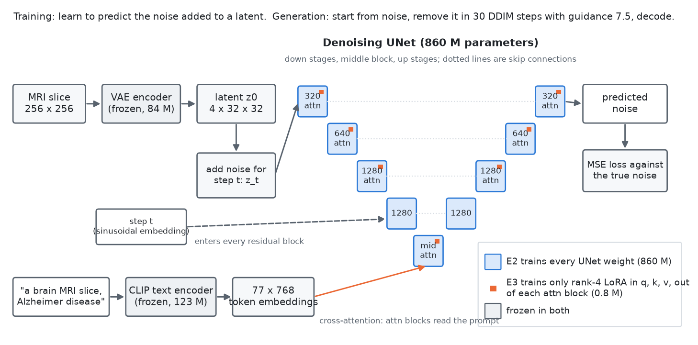

**Recipe**, and the failure each part fixes:

| Setting | Value | Why |
| --- | --- | --- |
| Length | 10 epochs at batch 16 | E0 trained less than one epoch |
| Optimiser | AdamW, lr 1e-5 (E2) or 1e-4 (E3), 500 warm-up steps, clip 1.0 | fine-tuning rate; adapters tolerate more |
| Offset noise | 0.1 | lets the model shift global brightness; E0 had grey backgrounds (Guttenberg, 2023; Lin et al., 2024) |
| Prompt dropout | 10% empty prompt | trains the branch guidance relies on; E0's pulled towards natural images |
| EMA | decay 0.999 | smoother weights for sampling |
| Data cleaning | 2 scans removed | E1 turned one blank scan into 7/32 blank NC samples |
| Precision | float32 weights, bfloat16 autocast | 93 images/s on one A100 |

**Code.** `dataset.py` (validated loader, hash checks, defective-scan rule),
`modules.py` (model loading, LoRA, loss, EMA, guided DDIM, DDIM inversion),
`train.py` (training loop, validation loss, curves, checkpoints), `predict.py`
(fixed-seed generation), `tools/` (baselines, Slurm jobs, and the evaluation
on the test split, kept apart from `train.py` so the test split stays sealed
until the code is frozen), `tests/` (CPU tests with tiny models).

## 5. How the models are judged

Every model is scored on the same fixed seeds and, for the final results, the
same 102 test subjects.

| Measure | How | Why | What it showed |
| --- | --- | --- | --- |
| SSIM (course target 0.6) | each sample against its nearest held-out slice of the same class | the course's structural measure | separates trained from untrained models, but rates a blurry VAE highest and a collapsed GAN at 0.58 |
| KID, FID | Inception-v3 features, 1,024 samples against the test set; real-slice floor | distance between distributions; KID is unbiased at this size | ranks the models where SSIM cannot |
| Precision, recall, density, coverage | Naeem et al. (2020), k = 5 | separates "looks real" from "covers the data" | VAE and GAN score zero coverage |
| Training preference (M2) | per sample, log(nearest-training / nearest-held-out distance), calibrated on real held-out slices | removes the bias that smooth samples sit close to everything | flags B3; E2 within 1.4% |
| Membership inference (M3) | denoising loss on 1,024 training against 1,024 test slices; SD as control | does the model reveal who trained it? | E2 and B3 leak, E3 barely |
| Visual review | uncurated grids, closest pairs, autopsy chosen by rule | tells a copy from a neighbour, an artefact from anatomy | found E1's blank samples and B3's copies |

## 6. From E0 to E3 (validation)

Each step changed one thing and was judged on validation data (64 fixed-seed
samples; real slices score 0.710).

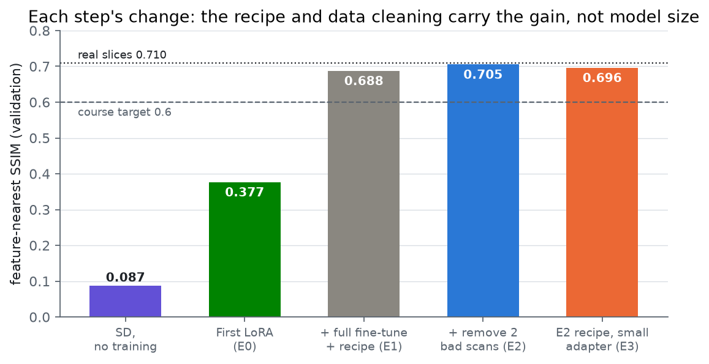

- **E0 to E1: the recipe fixes the failures.** Offset noise removed the grey
  background (border intensity 0.059 to 0.002) and prompt dropout the colour
  casts; SSIM rose from 0.38 to 0.69.
- **E1 to E2: data cleaning.** E1's 7/32 blank NC samples all traced to one
  defective scan (0.26% of NC slices). Removing two such scans removed them.
- **E3: capacity is not the bottleneck.** E0's small adapter with E2's recipe
  reaches 0.696: of the 0.328 gain from E0 to E2, the recipe gives 0.319 and
  training all 860 M weights 0.009. A second seed confirmed the gap is small
  but real (0.008, larger than the 0.005 seed spread).
- **B3: pretraining buys generalisation, not fidelity.** Trained from scratch,
  a UNet a ninth the size matches E2's SSIM (0.710), but it overfits:

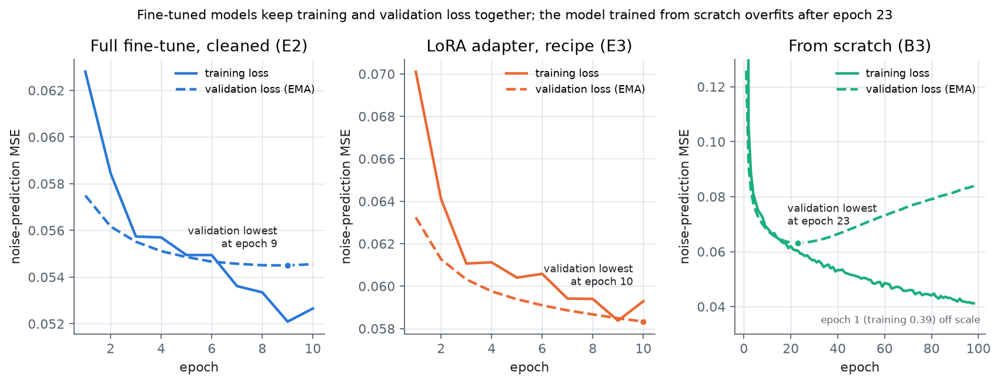

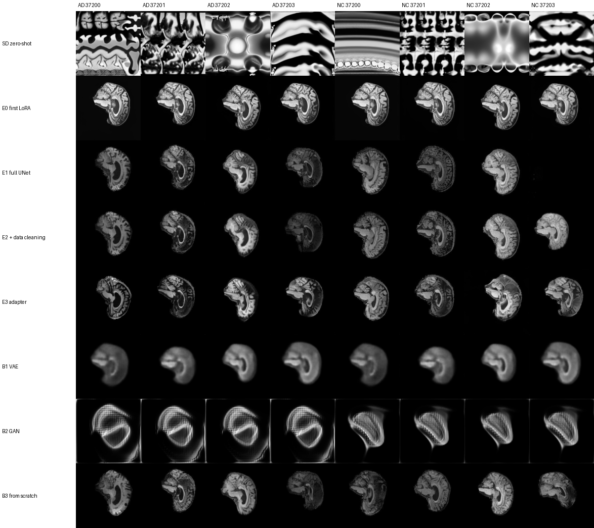

*The same seeds through every model (synthetic images only): SD draws natural
textures; E0 one pose on a grey field; E1's last NC sample is blank; E2 and E3
varied, plausible slices; the VAE blurs; the GAN repeats one template per
class.*

## 7. Test results

All models were evaluated once on the 102 test subjects (4,700 slices), 1,024
samples each, with the code frozen at commit `2104414` before the test split
was read ([protocol](docs/final-evaluation-protocol.md)). Intervals are
bootstrap 95%; the real floor is 1,024 validation slices scored as a generator.
B2b produced no model to test.

### 7.1 Fidelity and coverage

<!-- generated by tools/results_tables.py from the test split -->

| Model | Feature-nearest SSIM (95% CI) | > 0.6 | KID x 100 | FID | Precision | Recall | Density | Coverage |
| --- | ---: | ---: | ---: | ---: | ---: | ---: | ---: | ---: |
| Real slices (floor) | 0.707 | 100% | 0.06 | 8.4 | 0.754 | 0.755 | 0.648 | 0.813 |
| SD 1.5, no training (SD) | 0.088 (0.084 to 0.091) | 0% | 29.25 ± 0.32 | 311.0 | 0.000 | 0.476 | 0.000 | 0.000 |
| First LoRA, no recipe (E0) | 0.328 (0.310 to 0.346) | 36% | 10.92 ± 0.22 | 89.0 | 0.079 | 0.001 | 0.021 | 0.028 |
| **Full fine-tune**, cleaned data (E2) | 0.704 (0.703 to 0.706) | 99% | 1.27 ± 0.08 | 22.7 | 0.267 | 0.849 | 0.103 | 0.274 |
| Full fine-tune, 2nd seed (R1-E2) | 0.702 (0.700 to 0.704) | 99% | 1.19 ± 0.07 | 20.9 | 0.302 | 0.816 | 0.111 | 0.288 |
| **LoRA adapter**, same recipe (E3) | 0.696 (0.694 to 0.698) | 99% | 4.25 ± 0.14 | 48.7 | 0.065 | 0.675 | 0.019 | 0.066 |
| LoRA adapter, 2nd seed (R1-E3) | 0.694 (0.691 to 0.697) | 96% | 4.19 ± 0.15 | 47.6 | 0.044 | 0.751 | 0.011 | 0.035 |
| Diffusion from scratch, 92 M (B3) | 0.703 (0.701 to 0.705) | 99% | 1.99 ± 0.10 | 28.3 | 0.279 | 0.803 | 0.101 | 0.242 |
| Conditional VAE (B1) | 0.718 (0.716 to 0.719) | 100% | 23.84 ± 0.29 | 187.9 | 0.000 | 0.000 | 0.000 | 0.000 |
| Conditional GAN (B2) | 0.582 (0.576 to 0.587) | 49% | 38.98 ± 0.31 | 297.4 | 0.000 | 0.000 | 0.000 | 0.000 |

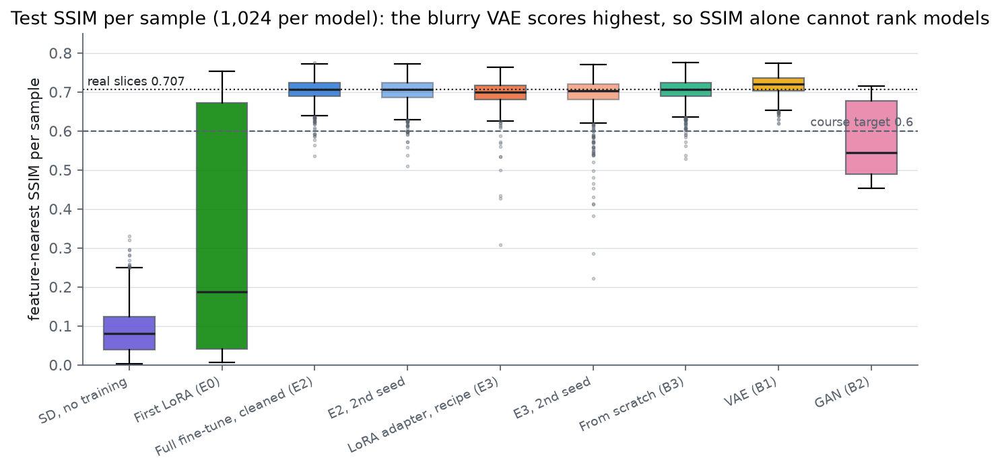

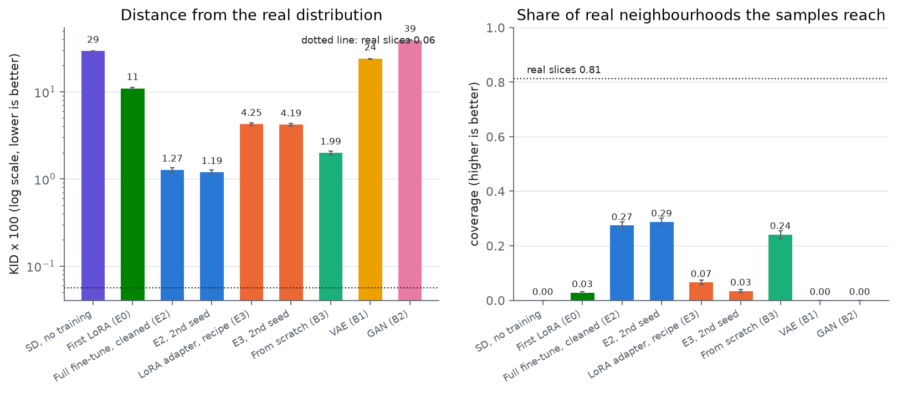

- **SSIM cannot rank the models:** every fine-tuned diffusion model and the VAE
  clear 0.6, within 0.694-0.718.
- **The distribution measures can.** E2 has the lowest KID and highest coverage
  of any model, reproduced by its second seed; B3 is second; E3's KID is three
  times E2's.
- **The simple baselines fail outright:** the VAE and GAN reach no real
  neighbourhood at all (coverage 0).
- **The remaining gap is coverage:** E2 reaches 27% of real neighbourhoods
  against 81% for real slices, and its precision (0.27 against 0.75) shows many
  samples carry features real slices lack (Section 8).

### 7.2 Memorisation

<!-- generated by tools/results_tables.py from the test split -->

| Model | Nearest-training RMSE, mean (min) | M2 pixel: difference (95% CI) | Closer to training (negative: farther) | M2 VAE: difference (95% CI) | Membership AUC | AUC minus SD (95% CI) | TPR at 1% FPR |
| --- | ---: | ---: | ---: | ---: | ---: | ---: | ---: |
| Real held-out slices | 0.0745 (0.0424) | 0 (calibration) | 0% | 0 (calibration) | | | |
| SD 1.5, no training (SD) | 0.4914 (0.2663) | +0.0740 (0.0712 to 0.0768) | -7.7% | +0.0932 (0.0895 to 0.0969) | 0.499 | control | 3.0% |
| First LoRA, no recipe (E0) | 0.1184 (0.0620) | +0.0273 (0.0219 to 0.0326) | -2.8% | +0.0572 (0.0514 to 0.0631) | n/a | n/a | n/a |
| **Full fine-tune**, cleaned data (E2) | 0.0683 (0.0387) | -0.0064 (-0.0131 to 0.0004) | +0.6% | -0.0145 (-0.0233 to -0.0058) | 0.736 | +0.237 (0.219 to 0.255) | 13.5% |
| Full fine-tune, 2nd seed (R1-E2) | 0.0711 (0.0374) | -0.0043 (-0.0111 to 0.0027) | +0.4% | -0.0122 (-0.0212 to -0.0034) | 0.732 | +0.234 (0.216 to 0.252) | 13.3% |
| **LoRA adapter**, same recipe (E3) | 0.0823 (0.0506) | +0.0257 (0.0207 to 0.0308) | -2.6% | +0.0269 (0.0202 to 0.0336) | 0.529 | +0.030 (0.014 to 0.047) | 1.8% |
| LoRA adapter, 2nd seed (R1-E3) | 0.0770 (0.0520) | +0.0106 (0.0049 to 0.0161) | -1.1% | +0.0109 (0.0040 to 0.0178) | 0.531 | +0.032 (0.016 to 0.049) | 1.9% |
| Diffusion from scratch, 92 M (B3) | 0.0519 (0.0172) | -0.3334 (-0.3515 to -0.3154) | +28.3% | -0.2720 (-0.2885 to -0.2566) | 1.000 | +0.501 (0.476 to 0.526) | 100.0% |
| Conditional VAE (B1) | 0.0560 (0.0347) | -0.0305 (-0.0372 to -0.0236) | +3.0% | +0.0337 (0.0290 to 0.0385) | n/a | n/a | n/a |
| Conditional GAN (B2) | 0.1243 (0.0849) | +0.0745 (0.0711 to 0.0780) | -7.7% | +0.0494 (0.0456 to 0.0533) | n/a | n/a | n/a |

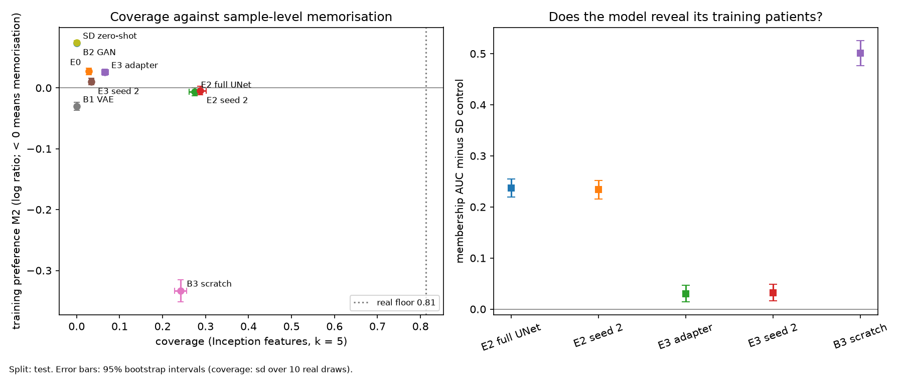

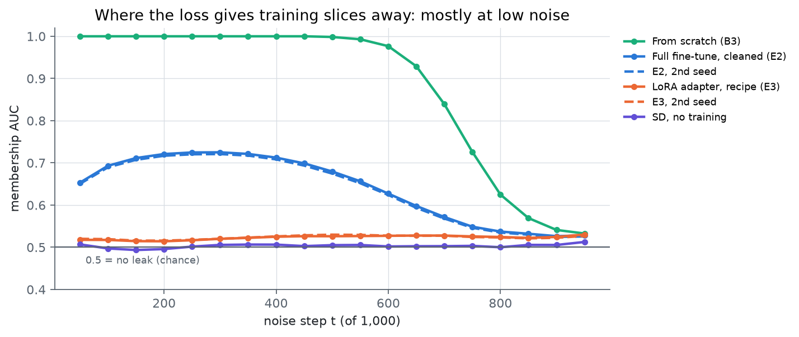

- **Samples.** B3's samples sit 28% closer to training slices than held-out
  slices would, and three different seeds reproduce one training slice. E2's
  pixel interval touches zero; in VAE features its samples are 1.4% closer. E3's
  are slightly farther.
- **Models.** With SD as control (0.499), the loss test recognises B3's
  training slices perfectly and E2's well (0.736), both confirmed by second
  seeds. The leak is strongest at low noise. E3 leaks little (0.529), but its
  interval excludes zero.
- **So sharing samples and sharing weights are different risks:** E2's samples
  carry little of its training set; its weights carry much more.

### 7.3 Samples, embedding and class

The first 32 seeds per class, as generated (no selection):

| E2 | E3 |
| --- | --- |
| 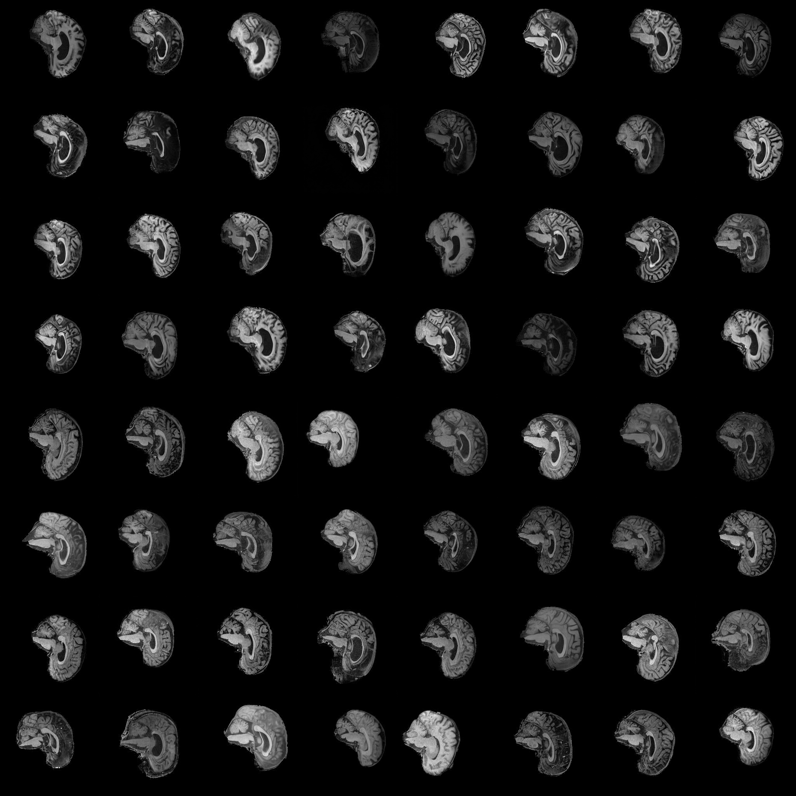 | 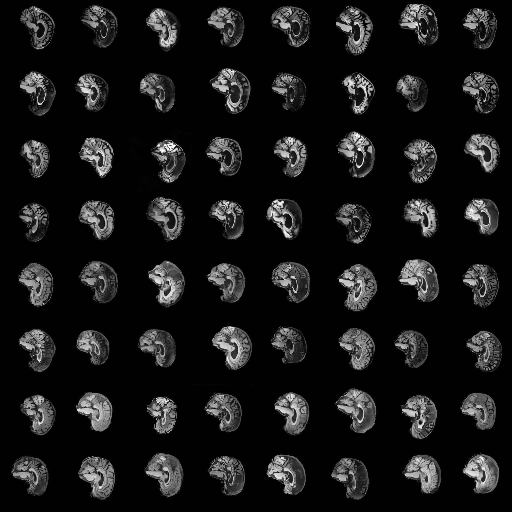 |

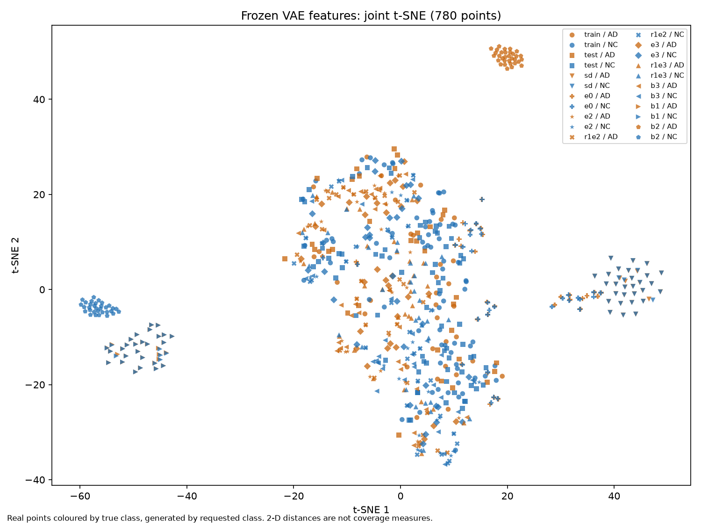

E2, E3 and B3 fall inside the cloud of real slices; SD, E0, the VAE and the GAN
form clusters of their own. Within the real cloud AD and NC mix: one slice
carries little sign of its class.

**Can a non-expert tell them apart?** In a blinded sort of 32 real test slices
and 32 E2 samples, the student (no medical training; shown 16 real training
slices first) was right on 42 of 64, 66% (95% CI 53-77%; chance 50%, p = 0.017).
12 of the 32 samples were taken for real, and 10 of the 32 real slices for
synthetic ([result](docs/test-blind-sort-2026-10-24.json)). The samples pass
as real often, but not as often as real slices do.

**Does the requested class show?** (post-hoc, not pre-registered.) A linear
probe fitted on validation slices separates real AD from NC test slices with
AUC 0.76. On samples split by the class asked for:

| | Real test slices | E2 | E3 | B3 | E0 | VAE | GAN | SD |
| --- | ---: | ---: | ---: | ---: | ---: | ---: | ---: | ---: |
| Probe AUC | 0.76 | **0.95** | 0.92 | 0.76 | 0.77 | 0.53 | 0.96 | 0.49 |

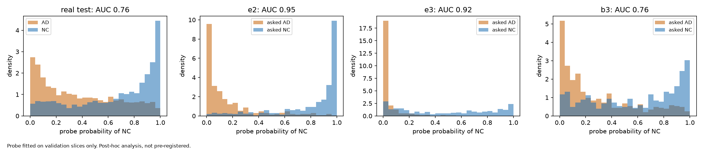

The conditioning works, but E2's classes differ more than real slices do: the
samples caricature their class, probably because guidance 7.5 extrapolates
along the class direction (not tested). The GAN's value comes from one template
per class.

### 7.4 Interpolation

Between two synthetic samples, E2's frames change continuously and never come
closer to a training slice than the closest real pair (0.042); one NC path jumps
in brightness between frames 5 and 6. Starting from a training slice (inverted
to noise by DDIM inversion, reconstruction RMSE 0.04-0.06), the distance to it
rises steadily to a typical sample distance: the model leaves training slices
gradually rather than switching between stored images. Panels that show
training slices stay private; the numbers are in
[test-interpolation-2026-10-19.json](docs/test-interpolation-2026-10-19.json).

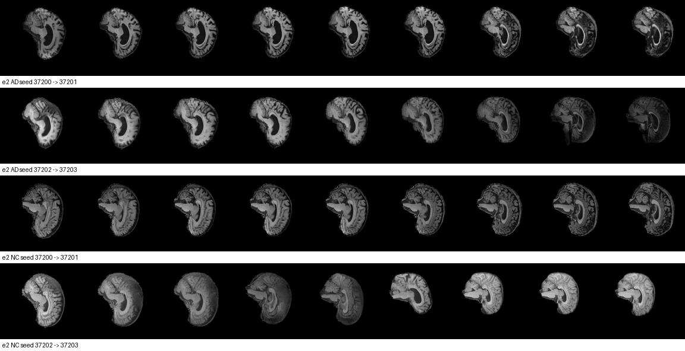

### 7.5 Cost

One A100-PCIE-40GB. Sampling: DDIM 30 with guidance 7.5, median of 20 batches;
"det." is the deterministic setting the cohorts used, "fast" a deployment
setting (TF32, fused attention).

| Model | Trainable parameters | Weight file | Training (wall) | Training peak | Sec/image, batch 1 (det. / fast) | Sec/image, batch 16 (det. / fast) | Sampling peak, batch 1 / 16 |
| --- | ---: | ---: | ---: | ---: | ---: | ---: | ---: |
| **Full fine-tune** (E2) | 859.5 M | 1.7 GB | 43 min (10 epochs) | 23.8 GiB | 1.97 / 1.32 | 0.49 / 0.23 | 3.8 / 8.7 GiB |
| **LoRA adapter** (E3) | 0.80 M | 1.6 MB | 38 min (10 epochs) | 36.8 GiB | 2.67 / 1.96 | 0.54 / 0.27 | 3.8 / 8.7 GiB |
| Diffusion from scratch (B3) | 92.2 M | 0.18 GB | 110 min (98 epochs) | 34.3 GiB | 1.90 / 1.29 | 0.32 / 0.11 | 0.9 / 5.8 GiB |
| Conditional VAE (B1) | 1.27 M | 5 MB | 3 min (5 epochs) | 0.15 GiB | 0.001 | < 0.001 | 0.4 GiB |
| Conditional GAN (B2) | 9.2 M (G) + 12.5 M (D) | 37 MB (G) | 105 min (29,000 steps) | 3.8 GiB | 0.002 | < 0.001 | 0.5 GiB |

The adapter's file is a thousand times smaller, yet its training peak is
higher than full fine-tuning (likely float32 copies kept by the adapter layers,
not verified), and unmerged it samples 35% slower. The GAN and VAE sample a
thousand times faster than any diffusion model but fail the other two corners.

## 8. Failure autopsies

1. **Grey backgrounds and colour casts (E0).** Only 23/64 samples were usable.
   SD1.5's noise schedule cannot learn a global brightness shift from zero-mean
   noise, and guidance extrapolated from a prompt branch never trained on MRI.
   *Fix:* offset noise and prompt dropout (E1).
2. **Blank NC samples (E1).** 7/32 NC samples were nearly black; their nearest
   training slices all came from one defective scan, a rare extreme item the
   model reproduced. *Fix:* the defective-scan rule (E2: 0/32).
3. **Mode collapse (B2, B2b).** From step 1,000, every sample in a class was the
   same non-anatomical template: the generator ignored its noise (Mao et al.,
   2019). The collapse check missed it because it pooled both classes. One GAN
   per class collapsed too, even after a calibration bug was fixed.
4. **Replicated training slices (B3).** The closest samples reproduce specific
   training slices' outlines and ventricles with smeared gyri. 92 M parameters
   from scratch on 21 k slices overfit after epoch 23 (Section 6), the
   replication Somepalli et al. (2023) describe.
5. **E2's worst test samples**, chosen by a rule fixed in advance (5 lowest SSIM
   of 1,024; no sample was near-empty):

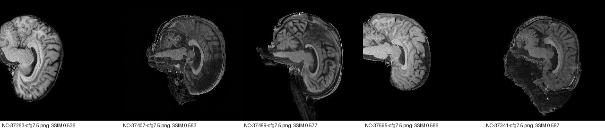

| Sample (SSIM) | What is wrong | Likely trigger (not verified) |
| --- | --- | --- |
| NC-37263 (0.536), NC-37595 (0.586) | over-bright, flat contrast, anatomy cut off at the edge | guidance pushes intensities to extremes; off-centre slices are rare |
| NC-37407 (0.563) | brainstem and cerebellum dissolve into disordered tissue | the most variable region; the model averages incompatible shapes |
| NC-37489 (0.577) | a stripe runs off the image; a bright rim circles the cortex | skull-stripping remnants in some training slices, exaggerated |
| NC-37341 (0.587) | lower half replaced by mottled texture | the same failure, more severe |

All five are NC, the more varied class. They are Section 2.4's "impossible
tissue junctions": rare, but present, and the reason E2's precision is low.

## 9. Recommendation

**Use E2 to generate a synthetic cohort; do not share its weights.**

*How it was chosen,* by the rule fixed before the test split was read:
neither E2 nor E3 is excluded (both SSIM > 0.6, no copies); both show a
memorisation signal (E3's membership excess, 0.014-0.047, excludes zero), so
that step does not decide; E2's coverage (0.274) beats E3's (0.066) by far more
than the seed spread. The rule ignores the size of a signal, so it is stated
below.

| Question | Verdict for the E2 cohort | Evidence |
| --- | --- | --- |
| Structural fidelity | **passes** | SSIM 0.704, 99% of samples above 0.6 (real 0.707) |
| Samples free of memorisation | **largely** | no copies; at most 1.4% closer to training than held-out slices |
| Model free of memorisation | **fails** | membership AUC 0.736 (control 0.499); 13.5% of training slices caught at 1% false alarms |
| Coverage | **best of all models, far from real** | KID 1.27 (floor 0.06), coverage 0.27 (floor 0.81) |
| Plausibility | **partly: a non-expert tells them apart two times in three; rare impossible anatomy** | blinded sort 42/64 correct (chance 50%, 95% CI 53-77%), 12 of 32 samples taken for real; grids, autopsy |
| Downstream use | **not established** | no train-on-synthetic, test-on-real study |

**Trade-offs.** If only images leave the hospital, use E2 and screen out the
rare impossible slices. If the model must be shared, use neither E2 nor B3: E3
leaks far less in a 1.6 MB file but covers a quarter as much; differential
privacy is the next step. Never train from scratch on data this small (B3).
The cohort is neither anonymous, nor clinically validated, nor shown to help a
classifier, and its classes are exaggerated.

## 10. Conclusion

Fine-tuned Stable Diffusion produced the most realistic and varied slices of
every model tested, with no copies and visible class conditioning. But no model
escaped all three corners of the trilemma: the VAE and GAN blur or collapse;
the best model still draws occasional impossible anatomy, and a non-expert
told its samples from real slices two times in three; and memorisation
grew with fit, from E3's small leak to E2's model-level leak to B3's copies.

Three lessons: the recipe and data cleaning, not capacity, delivered fidelity;
pretraining bought generalisation rather than fidelity; and SSIM alone misses
both collapse and replication. **Next steps:** differential privacy or earlier
stopping to cut E2's leak; lower guidance to reduce class exaggeration; then
radiologist review and a train-on-synthetic, test-on-real study.

## 11. Reproducing the results

**Environment.** Rangpur, one A100-PCIE-40GB per job; Python 3.11.15, PyTorch
2.13.0+cu130, torchvision 0.28.0, diffusers 0.40.0, transformers 5.18.0, peft
0.21.2, accelerate 1.15.0, safetensors 0.8.0, NumPy 2.4.6, Pillow 12.3.0,
matplotlib 3.10.9 ([requirements-train.txt](requirements-train.txt)); local
analysis in [requirements-evaluation.txt](requirements-evaluation.txt). SD1.5
revision `451f4fe16113bff5a5d2269ed5ad43b0592e9a14`, downloaded once with
hashes recorded.

Train E2 (about 45 min), then E3 (about 38 min):

```bash
python train.py --output outputs/e2 --exclude-defective-scans --expect-excluded 2 40
```

```bash
python train.py --output outputs/e3 --exclude-defective-scans --expect-excluded 2 40 --trainable lora --lora-rank 4 --lr 1e-4
```

Generate seeds 37200 onwards for each class (DDIM 30, guidance 7.5). The input
is a class (AD or NC) and a seed; the output is one 256 × 256 PNG per sample,
grids like those in Section 7.3, and a report with every file's SHA-256 and two
appearance statistics printed per class:

```bash
python predict.py --weights outputs/e2/weights/unet-ema-epoch-10.safetensors --output outputs/e2-cohort --count 32
```

For one class only, add `--classes AD` or `--classes NC`; a seed gives the same
image either way:

```bash
python predict.py --weights outputs/e2/weights/unet-ema-epoch-10.safetensors --output outputs/e2-ad --classes AD --count 100
```

Run the CPU tests:

```bash
python -m unittest discover -s tests
```

Seeds are fixed for data order, validation draws and every sample. Generation
is deterministic and reproduces earlier cohorts byte for byte; training uses
TF32 for speed. Every job is listed in the [ledger](docs/experiments.md), and
the README figures are redrawn by `tools/figure_report.py` from data in `docs/`.

## 12. Limitations

- No radiologist review. The blinded sort had one non-expert rater, who had
  seen real and synthetic examples beforehand; 64 items give a wide interval.
- Downstream utility is not measured.
- 2D slices, one dataset; two seeds for E2 and E3, one per baseline.
- KID and FID use ImageNet features, a convention rather than a validated MRI
  measure.
- Distance tests cannot prove the absence of memorisation; the membership test
  covers one attack, not all.

## 13. Artificial Intelligence Usage Disclosure

The dated record of every AI-assisted step, mistakes included, is
[AI_USAGE.md](AI_USAGE.md).

**Tools.** OpenAI Codex (2-8 October 2026) and Anthropic Claude Code with
Claude Opus 5.5 (12-25 October 2026), used as coding and research assistants
with access to the repository and, through the student's account, to Rangpur.

**What they did.** *Codex:* interpreting the assessment; the data audit that
found the 216 shared subjects; the subject-level split and `dataset.py`; E0;
the first audits; the VAE baseline. *Claude Code:* `modules.py`, `train.py`,
`predict.py`; the E1-E3 and R1 runs; the GAN and from-scratch baselines; the
final evaluation tools; the protocols, ledger, figures and this README. *The
student* chose the project, approved every protocol and GPU run before it
started, decided reruns and deletions, presented the check-off, and relayed the
tutor's feedback that reshaped the evaluation.

**Verification.** Hypotheses and pass criteria were committed before every
experiment, with deviations recorded as dated errata. CPU unit tests check the
sampler against diffusers' pipeline, DDIM inversion, the metrics against closed
forms and the data contract; key tests fail on deliberately broken code. Every
file copied to Rangpur, weight file and generated image was hash-checked, and
every Slurm job dry-run first. The evaluation code had to reproduce all earlier
validation SSIM values to six decimals before the test split was read. Every
grid and closest-pair panel was inspected before its numbers were interpreted.
Mistakes found and fixed are listed in AI_USAGE.md.

*Student verification:* "I reviewed and examined all AI-generated work,
assessed each proposal, personally carried out the verification and blinded
classification, and cross-checked the instructions in the README file against
the recorded accounts."

## 14. References

- Rombach, R., et al. High-Resolution Image Synthesis with Latent Diffusion Models. CVPR 2022.
- Ho, J., Jain, A., Abbeel, P. Denoising Diffusion Probabilistic Models. NeurIPS 2020.
- Song, J., Meng, C., Ermon, S. Denoising Diffusion Implicit Models. ICLR 2021.
- Ho, J., Salimans, T. Classifier-Free Diffusion Guidance. NeurIPS Workshop 2021.
- Hu, E., et al. LoRA: Low-Rank Adaptation of Large Language Models. ICLR 2022.
- Guttenberg, N. Diffusion with Offset Noise. Crosslabs blog, 2023.
- Lin, S., et al. Common Diffusion Noise Schedules and Sample Steps Are Flawed. WACV 2024.
- Heusel, M., et al. GANs Trained by a Two Time-Scale Update Rule Converge to a Local Nash Equilibrium (FID). NeurIPS 2017.
- Bińkowski, M., et al. Demystifying MMD GANs (KID). ICLR 2018.
- Naeem, M. F., et al. Reliable Fidelity and Diversity Metrics for Generative Models. ICML 2020.
- Carlini, N., et al. Extracting Training Data from Diffusion Models. USENIX Security 2023.
- Duan, J., et al. Are Diffusion Models Vulnerable to Membership Inference Attacks? ICML 2023.
- Somepalli, G., et al. Diffusion Art or Digital Forgery? Investigating Data Replication in Diffusion Models. CVPR 2023.
- Mao, Q., et al. Mode Seeking Generative Adversarial Networks for Diverse Image Synthesis. CVPR 2019.
- Mescheder, L., et al. Which Training Methods for GANs do actually Converge? (R1 penalty). ICML 2018.
- Kingma, D. P., Welling, M. Auto-Encoding Variational Bayes. ICLR 2014.
- Wang, Z., et al. Image Quality Assessment: From Error Visibility to Structural Similarity. IEEE TIP 2004.
- Shoemake, K. Animating Rotation with Quaternion Curves (slerp). SIGGRAPH 1985.
